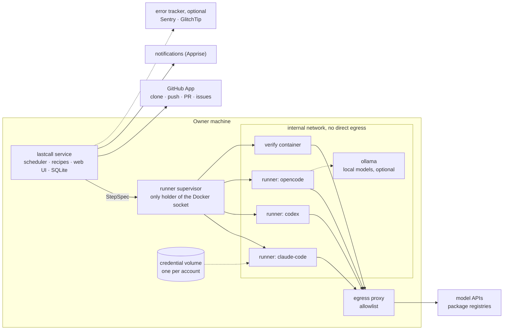

# lastcall design

Status: **v0.6 released, October 2026**, open for discussion. This document describes what lastcall is and how it
works. Section 17 says what is done and what comes next; open decisions are listed in section 19.

## 1. What lastcall is

AI coding subscriptions have usage limits that reset. Claude and ChatGPT plans have a rolling window of a few hours
and a weekly cap; other offers have daily or monthly allowances. Capacity that is not used before the reset is lost.

lastcall is a self-hosted service that watches those limits. When a reset is close and capacity is left over, it
spends that capacity on your repositories:

- **Audit.** Several reviewers (bugs, security, hygiene, performance) read the code together with the output of
  scanners. A judge checks every finding against the code, removes duplicates and false positives, and decides
  what becomes a pull request and what needs your decision.
- **Fix.** One implementer per pull request makes the smallest fix, with a regression test. lastcall runs the test
  suite again in a clean container, outside the agent, and scans the diff for secrets before it opens the pull
  request.
- **Improve.** On request, an improvement plan: ideas grounded in the project and checked against the code,
  delivered as an issue with checkboxes. lastcall builds the ideas you tick, one pull request each.

You review and merge. Nothing reaches your default branch without you.

lastcall started as a personal prototype, built in October 2026 and run against about twenty self-hosted projects.
Its measurements shape this design (section 16).

## 2. Goals and non-goals

Goals:

1. Spend only capacity that would otherwise expire. Keep a reserve for the owner. Stop before any paid usage.
2. Produce small, verified, reviewable changes, and few of them: the owner's review time is the scarce resource.
3. Use the tools people already pay for (the official CLIs), and also API keys and local models.
4. Be safe by construction: assume that everything the agents read (code, logs, issues) can contain prompt
   injection.
5. Make self-hosting easy: one `docker compose up` and a setup wizard, with no cloud dependency other than the model
   providers and the forge.

Non-goals for v1:

- A hosted service, or several users per instance.
- A general-purpose workflow engine. Recipes have fixed shapes (section 9).
- An interactive coding assistant.
- Continuous review of other people's pull requests.
- Deployment. Your CI/CD deploys; lastcall stops at the merge (section 11).

## 3. Provider terms and responsible use

Subscription plans are meant for each vendor's own tools, and the vendors say so. As of October 2026:

- **Anthropic** states that OAuth for Claude plans is for ordinary use of Claude Code and Anthropic's native
  applications. Third-party developers may not offer Claude.ai login, may not route requests through Free, Pro or
  Max credentials on behalf of their users, and may not handle Claude.ai credentials. Anthropic documents a
  long-lived token for scripts.
  ([legal and compliance](https://code.claude.com/docs/en/legal-and-compliance),
  [IAM](https://code.claude.com/docs/en/iam))
- **OpenAI** documents Codex access tokens for ChatGPT Business and Enterprise workspaces, for non-interactive
  workflows such as scripts, scheduled jobs and CI runners.
  ([access tokens](https://developers.openai.com/pt-BR/docs/enterprise/access-tokens))
- **Google** changed the Gemini CLI offer for personal accounts in mid-2026. Its status is unclear, so it is not part
  of v1. ([quotas](https://developers.google.com/gemini-code-assist/resources/quotas))

lastcall's rules follow from that:

1. It runs each vendor's official, unmodified CLI. It never calls a subscription API with a token of its own and
   never re-implements a vendor's client.
2. It never sees subscription credentials. The owner signs in with the CLI's own login flow, inside a credential
   volume that only that account's runner containers mount. `lastcall login` only starts that flow (`claude auth
   login`, `codex login --device-auth`) in a container with the isolation of a step, on the owner's terminal.
3. API keys and local models are a first-class alternative. Since v0.5 the `opencode` engine runs on them; the
   API keys of the other engines may follow. lastcall holds such a key itself (section 12): no vendor login applies.
4. When the owner connects an account, lastcall shows a summary of that provider's current terms with a link to the
   source. The owner decides.
5. There will be no hosted version.

This is not legal advice. Terms change: the provider table in the documentation carries the date it was checked,
and every release checks it again.

## 4. Concepts

| Term | Meaning |
|---|---|
| Account | A source of capacity: a subscription seat, an API key with a budget, a local model server. It has an engine, a way to sign in, a quota reader, a spend policy and a tier map. |
| Engine | An agent CLI that runs one step inside a runner container: `claude-code`, `codex`, later `opencode` and others. |
| Tier | The capability a step asks for: `fast`, `balanced` or `deep`. Each account maps tiers to a model and a reasoning effort. |
| Project | A repository and its settings: recipes, limits, test command, environment, and optional signals and knowledge. |
| Recipe | A pipeline with a fixed shape and configurable slots: `audit`, `improve`, later `issues`, `tests`, `deps`. |
| Run | One execution of a recipe on a project. A run is made of steps. |
| Step | One unit of work: an agent call (reviewer, judge, implementer…) or a deterministic action (collect context, verify, deliver). |
| Finding | A problem that a reviewer reports, with file, lines and evidence. The judge gives it a verdict and a decision. |
| Delivery | How results reach the owner: pull request, draft pull request, issue with checkboxes, or report only. |

## 5. Architecture



- **Service.** One Python process: quota polling, scheduler, recipe engine, forge client, notifier and web UI. State
  lives in SQLite. The service holds the forge credentials; agents never do.
- **Runner supervisor.** A small separate process, and the only component with the Docker socket. It has no
  network of its own and listens on a Unix socket. A request names an engine (never an image), the workspace, the
  files for `/ctx`, the account volume and a timeout. The supervisor refuses any path outside `runs/` on the data
  volume, any volume that is not an account volume and any proxy setting, and it always applies the same flags. A
  bug in the service cannot start an arbitrary container. For the signals it also lists the containers on its host,
  and reads, and only reads, the recent logs and state of those that the service names; never those of lastcall's
  steps (section 8).
- **Runners.** One ephemeral container per step: user 1000, `--cap-drop ALL`, `no-new-privileges`, memory, CPU and
  process limits, on an `internal` Docker network whose only way out is the egress proxy. Mounts: the workspace
  (read-only for reviewers and the judge, writable for an implementer, on its own clone), `/ctx` read-only, and the
  account's credential volume at the CLI's home. An account on an API key has no volume: its key comes as a file in
  `/ctx`. Runners have no forge token, no SSH keys and no Docker socket. The image holds the official CLIs at pinned
  versions, Python 3.12 and Node.js 22.
- **Local model server.** Optional: the compose service `ollama`, on the sandbox network only, which steps reach
  directly. It has no way out, so no step can make it download anything. Models come in only through `ollama-pull`,
  a separate container on the outside network that the owner runs.
- **Data volume.** `runs/` belongs to the service, which runs as user 1000 like the runners, so an implementer can
  write to its clone. `steps/<id>/ctx/` exists only while its step runs.
- **Egress proxy.** Allows HTTPS `CONNECT` only to an allowlist built from the engines (model APIs, auth endpoints,
  and models.dev, where OpenCode reads the prices) and from the package registries of the supported ecosystems. It relies on a Docker `internal` network, not on host
  firewall rules, so it works the same on Linux and on Docker Desktop.
- **Forge.** A GitHub App that each instance creates in the owner's account through GitHub's manifest flow. The App
  authors the pull requests, so the owner can approve them.
- **Notifications.** Apprise URLs: Telegram, ntfy, Discord, Slack, email and many more. Notifications only inform;
  the owner controls lastcall from its web UI or its CLI.

### Life of a burst

1. Every 15 minutes the service reads the quota of each account, without any model call. An account on an API key
   or a local model plans every minute instead, from lastcall's own ledger.
2. An account whose expiring window would reset with capacity left over enters burst mode. So does an account on a
   key while its spending is behind the calendar month, and one on a schedule during its hours.
3. The ranking picks a project. The service clones it and builds the context pack, without any model call.
4. The reviewers run one after another: the first one writes the provider's cache and the others read it. Then the
   judge runs.
5. For each pull request that the judge planned, an implementer works in its own clone. lastcall verifies the
   change, scans it, commits, pushes and opens the pull request.
6. The gates run before every step. If a throttle window is full, the run waits for its reset. If the reserve is
   reached, in the account's window or in the window of the step's model, the run stops and continues in the next
   burst.
7. The owner reviews and merges. Findings, decisions and outcomes feed the next run.

## 6. Accounts, quota and spending

### Quota windows

A quota reading is a list of windows, and each window has a role:

- **Expiring** windows decide *whether* to spend: their leftover is lost at the reset. Examples: the weekly window
  of a subscription, a monthly credit grant, a daily free allowance.
- **Throttle** windows decide *when* to wait: when one is nearly full, the next step waits for its reset. Examples:
  the 5-hour window of Claude and ChatGPT plans, per-minute limits.

```python
@dataclass
class Window:
    name: str  # "5h", "week", "day", "month"
    used_pct: float
    resets_at: float | None  # epoch seconds
    role: Literal["expiring", "throttle"]
    model: str = ""  # the model it limits, such as "Opus"; "" for the whole account
```

A window can also limit **one model**. Claude reports a weekly window for some models (Opus, Sonnet, and others that
the server names). Such a window does not decide whether to spend: only the account's windows do. It limits the steps
whose model name holds the window's model, word by word: `Opus` limits `opus`, `opus[1m]` and `claude-opus-5-5`,
and not `haiku`.

Each quota reader declares its **fidelity**:

- `exact`: the provider reports usage (Claude's usage request, the Codex app-server `account/rateLimits/read`,
  OpenRouter key usage);
- `events`: rate-limit events and 429 responses seen during runs;
- `ledger`: lastcall's own accounting of what each step cost, against the monthly budget that the owner declares
  (accounts on API keys). Its one window, `budget`, is expiring and resets with the calendar month (UTC);
- `none`: there is nothing to count against (a local model), so only the `schedule` policy, or the owner, starts
  runs.

The two exact readers that exist today use experimental CLI interfaces. Engine versions are therefore pinned and
updated on purpose, and the readers fall back to `events`. Each one is a small script (`lastcall.probes`) that runs
in the sandbox with the account volume mounted:

- Claude Code: a stream-json session with the `initialize` and `get_usage` control requests. The answer carries
  `rate_limits.five_hour` and `rate_limits.seven_day` (`utilization` 0–100, `resets_at`) and `extra_usage.is_enabled`.
  The weekly windows of one model come as `seven_day_opus`, `seven_day_sonnet` and the `model_scoped` list, where the
  server names each model (`display_name`).
  For the CLI, fetching the plan usage is "nonessential traffic": with `CLAUDE_CODE_DISABLE_NONESSENTIAL_TRAFFIC=1`,
  the runner default, `rate_limits` comes back null. The probe unsets it and keeps telemetry and error reporting
  off.
- Codex: `codex app-server`, `initialize` and then `account/rateLimits/read`. The answer carries `primary` and
  `secondary` windows (`usedPercent`, `windowDurationMins`, `resetsAt`), `credits` and `spendControlReached`. It
  also has `rateLimitsByLimitId`, one snapshot per metered bucket, where `codex` is the general one. lastcall reads
  only the general one so far: the accounts tested have no other.

### Spend policies

- `before-reset`, the default for subscriptions:
  - leftover = 100 − used − reserve, on the expiring window;
  - hours needed = leftover ÷ rate;
  - a burst starts when the time to reset falls below hours needed × 1.1 + 1, and never more than
    `max_lead_hours` (default 48) before the reset.

  The rate is the share of the expiring window that a burst can spend per hour, as limited by the throttle windows.
  lastcall **learns** it per account from past readings; a default per plan bootstraps it.
- `budget`, the default for API keys: a monthly budget in USD, for the calendar month (UTC).
  - The ledger keeps what each step cost, as OpenCode reports it with the prices of models.dev.
  - A burst starts while the share of the budget spent is behind the share of the month gone: a burst early in the
    month leaves room for the rest of it.
  - The gate stops the steps when the budget is spent. A step that is already running finishes, so the owner gives
    the key its own limit at the provider too.
  - A step that used tokens with no price stops the run: the budget could not hold. Free models (OpenRouter's
    `:free`) cost nothing, rightly.
- `schedule`, the default for local models: a cron expression in UTC, five fields (`* 1-6 * * *` is every night
  from 01:00 to 06:59). A burst starts in the minutes that match; a run that starts inside the schedule may end
  after it. An API key on a schedule keeps its monthly budget.
- `manual`: only runs that the owner starts. An API key keeps its budget here too.

An account on an API key keeps no reserve: its budget is the owner's limit.

The gates run before every step:

- the account is not above its reserve, and neither is the window of the step's model;
- no throttle window is above its threshold (default 90%); otherwise the step waits for that window's reset;
- **no paid usage is active.** If extra usage, credits or overage billing are enabled on the account, lastcall
  stops and tells the owner.

The first step of a run also checks the models of the steps after it, such as the judge's. A run whose judge could
not start therefore stops before its reviewers spend anything. For the same reason, an account does not burst while
the window of a model that the audit needs is at the reserve.

### Tiers and models

Recipes ask for a tier. Each account maps tiers to a model and an effort, and a per-role override exists for
tuning. Model catalogs change every month, so the defaults live in a data file in the repository, not in code.

```yaml
accounts:
  - id: claude-max
    engine: claude-code
    login: cli                 # official login inside the account's credential volume
    tiers: {fast: haiku, balanced: sonnet/high, deep: opus/high}
    spend: {policy: before-reset, reserve_pct: 10}
  - id: chatgpt-plus
    engine: codex
    login: cli
    tiers: {fast: gpt-6-luna/high, balanced: gpt-6.1-sol/medium, deep: gpt-6.1-sol/high}
    spend: {policy: before-reset, reserve_pct: 10}
  - id: openrouter             # v0.5
    engine: opencode
    provider: openrouter       # or anthropic, openai: an API key that lastcall keeps in its secret store
    tiers: {fast: qwen/qwen3-coder-flash, balanced: qwen/qwen3-coder-flash, deep: qwen/qwen3-coder}
    spend: {policy: budget, usd_per_month: 20}
  - id: local                  # v0.5
    engine: opencode
    provider: ollama           # the compose service `ollama`, at http://ollama:11434/v1
    tiers: {fast: qwen3-coder, balanced: qwen3-coder, deep: qwen3-coder}
    spend: {policy: schedule, cron: "* 1-6 * * *"}
```

An account can name its own models. An engine with no defaults in the data file (`opencode`) needs them: the owner
gives one model, and maybe a cheaper one for the reviewers (the `balanced` and `fast` tiers). A model of the
account's own keeps the default effort of its tier.

**Several accounts on one project.** Different providers find different problems (section 16). A review step can
therefore fan out across accounts, and one judge merges the results.

### Engines

| Engine | Subscription | API key | Other backends |
|---|---|---|---|
| `claude-code` (v0.1) | Claude plans, through the `claude` login | Anthropic API | Anthropic-compatible gateways (`ANTHROPIC_BASE_URL`) |
| `codex` (v0.1) | ChatGPT plans, through `codex login`; access tokens for Business and Enterprise | OpenAI API | OpenAI-compatible providers (`model_providers`), local models |
| `opencode` (v0.5) | — | OpenRouter, Anthropic, OpenAI | Local models on Ollama |

## 7. Engine contract

```python
class Engine(Protocol):
    name: str  # the id in accounts, settings and commands: "claude-code"
    title: str  # the CLI as people know it: "Claude Code"
    provider: str  # whose plans or keys it spends: "Claude"
    capabilities: frozenset[str]  # "json_schema", "system_prompt_file", "effort"
    egress: tuple[str, ...]  # domains the CLI needs, for the egress allowlist
    home: str  # where the CLI keeps its login; the account's credential volume is mounted here
    home_env: str  # the variable that points the CLI at `home`
    login: tuple[str, ...]  # the CLI's own interactive login; empty for an engine on API keys

    def invocation(self, step: StepSpec) -> Invocation: ...  # argv, stdin, env, files and mounts
    def parse(self, line: str) -> Event | None: ...  # tool use, message, usage, rate limit, result, error
    def result(self, step: StepSpec, events: Sequence[Event]) -> StepResult: ...


class QuotaProbe(Protocol):  # an engine that can read its account's quota without calling the model
    def quota_invocation(self) -> Invocation: ...
    def quota_reading(self, account: str, lines: Sequence[str], now: float) -> Reading: ...


class Keyed(Protocol):  # an engine on API keys that lastcall holds, or on a local model server
    providers: tuple[Provider, ...]  # each with its title, where to create a key and where its models are listed

    def with_key(self, provider: str, key: str | None, base_url: str | None = None) -> Engine: ...
```

The rest of lastcall works only through this contract:
- the supervisor runs every engine of the registry (`lastcall.engines.BUILTIN`) on the runner image, unless
  `LASTCALL_RUNNER_IMAGE_<ENGINE>` sets another;
- the egress allowlist comes from the engines' `egress`;
- the web UI shows `provider` and `title`;
- the burst rate is learned from whatever windows an engine's quota reader reports;
- one compose service, `login`, signs in any engine through `runner/login.sh`; an engine on API keys has nothing to
  sign in, and the script says so;
- an engine on API keys gets its account's key at run time (`with_key`), and passes it to the step as a read-only
  file in `/ctx`, never on the command line or in the environment. The web UI offers its providers.

[CONTRIBUTING.md](CONTRIBUTING.md#adding-an-engine) lists the steps to add an engine.

Rules for engines:

- **The container is the sandbox.** The mount enforces read-only access and the proxy enforces network access. An
  engine can therefore run its CLI in the CLI's non-interactive, fully automatic mode; lastcall does not rely on each
  CLI's own permission system.
- **Shared context goes where the provider caches it.** The steps of a run share a large prefix (the context pack
  and the code). Claude Code caches it when it comes through `--append-system-prompt-file`; Codex caches a common
  message prefix. In the prototype this cut the cost of the reviewers by 61%. The engine decides where the prefix
  goes; recipes only mark it as shared.
- **Structured output.** Steps return JSON validated against a schema. Engines with native schema support use it.
  OpenCode has none: its steps get the schema in the prompt, and their output is the JSON of the last answer, also
  inside a code fence. An answer that is not that JSON fails the step; asking once for a repair is still to come.
- **Normalized events** feed the run log, the ledger and the `events` quota reader.
- **A `scripted` engine** replays recorded event streams, so recipes run end to end in tests and in CI without
  spending quota.

## 8. Projects

### Onboarding

1. **Connect GitHub.** The wizard creates the instance's GitHub App through the manifest flow. Permissions: contents,
   pull requests and issues read and write, metadata read; no workflows, no administration and no webhooks (lastcall
   asks GitHub when it needs to). The owner installs the App on all repositories or on selected ones. The
   installation is the security boundary: lastcall cannot touch anything else. The web UI does it from its GitHub
   App page; `lastcall github setup` serves the same one-button page from the command line.
2. **Suggestions.** For each installed repository, lastcall works out whether it is worth activating and says why,
   without any model call: recent activity, tests or CI, supported language, size, open issues, not a fork and not
   archived. The points are in `lastcall.suggest`. Each suggestion shows the size of the code an audit reads. Once
   audits are measured per account, it will also show their cost and how many fit in the current leftover, for
   example "about 1.5% of your week per audit; about 12 fit".
3. **Add by URL.** If the App is not installed on that repository, lastcall links to the install page. A repository
   that the owner does not control can only run in report-only mode: lastcall never opens pull requests on other
   people's projects.

### Settings

Each project has: active or not, weight, recipes and their limits, test command, environment, focus, delivery
mode, merge on approve, and the watch after the merge with its health address. Settings live in the database and the
owner edits them in the web UI. An optional `.lastcall.yml` in the repository overrides them and is versioned with
the code, except for merge on approve and the watch: anyone who can open a pull request could otherwise turn them
on.

```yaml
# .lastcall.yml (illustrative)
recipes: [audit]
test: pytest -q
environment:
  image: python:3.12-slim
  setup: pip install -e ".[dev]"
exclude: [migrations/, vendor/]
focus: The public API in src/api matters most.
```

### Ranking

When an account bursts, it picks the next project with a cheap score:

- never audited by this account, or days since the last audit;
- new commits since the audited commit;
- pending findings;
- what the owner asked for, which goes first and instead of an audit: the ideas ticked in an improvement plan, then
  the issues labelled `lastcall`;
- errors in production in the last day, from the owner's error tracker and the kinds of errors in the logs of the
  project's containers (5 points each, up to 25); the service counts them every 30 minutes.

It skips projects that the same account audited recently, unless the owner asked for something there; projects with
unreviewed lastcall pull requests piling up; and very large projects when little quota is left. The project weight
multiplies the score.

### Optional context

- **Knowledge.** By default, the repository's own `AGENTS.md`, `CLAUDE.md`, `README` and `docs/`. Optionally, an MCP
  server.
- **Signals.** Errors in production, from Sentry or GlitchTip (`lastcall.signals`). They enrich the audits, the
  tests and the ranking, and they are never required:
  - The owner keeps one connection, in the secret store: the tracker's address, the organization and a token that
    can only read (`project:read` and `event:read`). lastcall saves it only after one request with it gets through.
    Each project names its project in the tracker.
  - Both trackers serve the same API: the project's id from `/api/0/projects/{org}/{project}/`, its unresolved
    issues from `/api/0/organizations/{org}/issues/?project={id}&query=is:unresolved`, and the latest event of each
    from `.../issues/{id}/events/latest/`. GlitchTip does not sort by frequency (`sort=freq`), so lastcall reads the
    100 seen last and sorts them by count itself. Checked against GlitchTip 6.2.6 with the Sentry SDK.
  - The pack gets the 8 most frequent unresolved errors of the last 14 days, each with up to 6 frames of the project's
    own code (`inApp`): file, line, function and code line, with the tracker's paths turned into the repository's.
  - What reaches a model is masked: emails, IP addresses, credentials in URLs, tokens (the secret scanner's rules,
    and any long opaque string) and long numbers. Variables, request data, user data, tags and breadcrumbs are never
    read.
- **Container logs** (`lastcall.logs`), for apps that run in Docker on lastcall's own host, with no change to their
  code. None is read until the owner gives it a project:
  - The settings page lists the host's containers (`lastcall logs list` in the terminal), and the owner chooses the
    project of each one to read. lastcall suggests one from the container's image (`ghcr.io/<owner>/<name>`, without
    its tag), else its Compose project, else its name (`<name>-web-1`), when only one project fits. A suggestion is
    read only once the owner saves it, and a no to it is remembered, so that it is not suggested again. The choices
    live in the service's database.
  - A container labelled `lastcall.project=<owner/name>` in its compose file is read for that project, matched
    without regard to case, with no choice: the choice can live with the app.
  - The supervisor lists the containers (their names, images, state and Compose labels) and reads, and only reads,
    those that the service names: their state (restarts, the kernel killing them for lack of memory, the exit code)
    and the logs of the last 24 hours, 5,000 lines and 2 MB per stream at most, from 10 containers at most. It keeps
    the two streams apart: Docker stamps the lines of each as it reads them, so the order between the two is not
    known. It never lists or reads the containers of lastcall's steps, and it never starts, stops or changes a
    container.
  - lastcall groups the lines into kinds of errors: a Python traceback by its exception and the place in the code
    where it happened (the last exception of a chain), a stack of Node.js or Java by its first line with its
    frames, and any other line with an error level (`ERROR`, `CRITICAL`, `FATAL`, `PANIC`, `level=error`,
    `[error]`) by its text without the app's own timestamp, numbers, ids and quoted values.
  - The pack gets the 8 most frequent kinds, each with one masked sample line, how often and when, and the frames,
    and the state of each container. The service counts the kinds for the ranking.
- **Logs in Loki** (`lastcall.loki`), for apps on other hosts, when Grafana Loki already collects their logs (with
  Grafana Alloy, Promtail or Docker's Loki driver). Nothing runs on those hosts:
  - The owner keeps one connection, in the secret store: Loki's address and, when Loki asks for one, a login that
    can read (basic, for Grafana Cloud or a proxy, else a bearer token), and a tenant for a Loki with more than one.
    lastcall saves it only after one request with it gets through.
  - The settings page lists the sources that Loki saw in the last 7 days (`/loki/api/v1/series`): the values of the
    label that names them, `container` when Loki has it, else `container_name`, `service_name`, `app` or `job`, or
    the one that the owner picks, each with its hosts and its Compose project. The owner chooses the project of each,
    with the suggestions of the container logs. A container of lastcall's steps is never listed.
  - For each chosen source, lastcall asks `/loki/api/v1/query_range` for the newest 5,000 lines of the last day that
    a filter keeps: those that may be part of an error (error levels, tracebacks with their last line, the frames of
    stacks), so that busy apps keep a day's errors. It asks for the stream's labels apart from each line's metadata
    (`categorize-labels`: Loki 3 would otherwise split a stream by the level that it detects in each line), puts the
    pieces of a stream back together (Loki shards a busy one) and reads each stream as a container's. Checked
    against Loki 3.7, with the logs of 29 containers that Grafana Alloy collected.
  - The pack gets a section of its own, and the service counts its kinds for the ranking with the containers'.
- An agent for the containers of other hosts without Loki may come later.

### Other forges

lastcall supports GitHub. The `Forge` interface (list, clone, push a branch, open a pull request, read approvals,
merge, issues, labels) leaves room for GitLab, Gitea and Forgejo, which come when people ask for them.

## 9. Recipes

A recipe is not a free-form workflow. It is one of a few fixed **shapes** with configurable **slots**, and the same
engine runs all of them with the same guarantees.

### Shapes

- **find → judge → fix → verify → deliver**: `audit`, `tests` and `deps`.
- **ideate → edit → deliver**: `improve`.
- **issue → fix → verify → deliver**: `issues`. The owner labels an issue, and leftover quota solves it.

Today `lastcall audit <owner/name>` runs the whole audit. With `--report-only` it stops after the judge, and
`lastcall deliver <run>` later opens the pull requests of that report, so the owner can read the findings first.
- The context pack (`lastcall.pack`) holds the README, the recent history, the scanners' results, a map and the
  code with line numbers, up to 150k tokens. The judge also gets the memory of earlier findings, and the
  reviewers the errors in production, from an error tracker, container logs or Loki (section 8).
- Each implementer works in its own clone, on a branch `lastcall/<date>-<n>-<topic>`.
- lastcall then takes over:
  - it runs the project's check (`lastcall.verify`) on a clean copy, in the runner image;
  - it scans the added lines, the title and the body for secrets (`lastcall.secretscan`);
  - it commits as the App's bot, pushes, and opens the pull request with a footer that says what was verified.
- Valid findings that need the owner go to one issue per run.
- **Fan-out.** Other accounts can review in the same run (`peers`). Each account's reviewers work at the same time
  as the others', in their own sandbox steps with their own account volume and quota gate. A peer whose gate closes
  stops reviewing, and the run goes on. Their findings carry `@<account>` in their ids, so the judge and the pull
  request footers say who found what. One judge, the run's own account's, weighs every finding and marks the same
  problem found twice as a duplicate; that account also implements. The owner asks for it with "All free accounts"
  in "Audit now", or `lastcall audit --account a --account b`; with the fan-out setting on, accounts that burst at
  the same time review one project together, and the one with the most quota left before its reset leads.

`lastcall improve <owner/name>`, or "Improve now" on the Projects page, runs the other shape:
- The **ideator** (deep tier) reads the same context pack, without the scanners, and the ideas of earlier plans with
  what became of them. It proposes improvements that fit the project and one pull request each: a small feature
  that completes one the project has, an error message that leaves users stuck, documentation that the code
  contradicts, a slow path. Bugs and security faults are the audit's.
- The **critic** (deep tier) checks every idea against the code: `keep`, `exists`, `duplicate`, `against` a
  documented decision, `vague` or `too_large`. It keeps at most 6, the most valuable and smallest first.
- They go to **one issue, the improvement plan**, with a checkbox per idea and a hidden mark that ties each box to
  its idea. The plan goes through the secret scan before it is published.
- `lastcall.sync` reads the plan, and a ticked idea becomes `wanted`. The next run on the project builds the wanted
  ideas, one pull request each and up to the project's limit, the way an audit builds its fixes
  (`lastcall.recipes.build`): its own clone, the check outside the agent in the project's environment, one more
  attempt, the secret scan. A burst that picks the project builds them instead of auditing it, and so does "Improve
  now".
- An idea that cannot be built is `stuck`, with why. Closing the plan dismisses the ideas that were not ticked;
  closing it as not planned also dismisses the ticked ones not built yet. While a plan has ideas to tick, a new plan
  waits.

The `issues` recipe (`lastcall.recipes.issues`) works on the issues that the owner labels `lastcall`:
- `lastcall.sync` creates the label once in each active project, and reads its open issues with the label: each one
  waits for a run. A burst that picks the project works on them, after the ideas ticked in a plan, instead of
  auditing; `lastcall issues <owner/name>` does it at once.
- The implementer (deep tier) gets the issue's text and the comments of people who may write to the repository, and
  works like any other (`lastcall.recipes.build`), up to the project's limit, the oldest issue first. The pull
  request says `Fixes #<n>`, so merging it closes the issue.
- When the issue is unclear, needs a decision or does not fit in one pull request, or the change fails its checks
  twice, lastcall says why in a comment on the issue and takes the label off. lastcall also takes it off when the
  owner closes its pull request without merging. Labelling the issue again asks for a new attempt.

The `tests` recipe (`lastcall.recipes.tests`) has the audit's shape, aimed at the behavior that no test checks:
- One reviewer, `tests` (balanced tier), finds behavior that matters and that no test reaches: a bug fix in the
  history with no test that would catch it again, core logic whose branches no test takes, a public interface that
  no test calls. Never coverage for its own sake.
- Its judge keeps what tests can check as the code is today. When today's behavior looks wrong, the finding goes to
  the owner's decisions instead: a test must not set a bug in stone.
- The test writer (deep tier) adds tests only, next to the existing ones and with their conventions. lastcall
  refuses a change to anything that is not a test: a path in a tests folder, or named the way tests are named
  (`test_*.py`, `*_test.go`, `*.test.ts`, `*Test.java`...). Then it checks the change like any other. Tests inside a
  source file, such as Rust's `#[cfg(test)]`, are out of reach.
- Each recipe keeps its own memory of findings: the judge of the tests sees only earlier tests.
- The owner turns it on for a project with "Tests too". "Write tests now" on the Projects page, or
  `lastcall tests <owner/name>`, starts one at once.

The `deps` recipe (`lastcall.recipes.deps`) has the same shape, aimed at the dependency upgrades that need more than
a new version number, which a bot such as Dependabot cannot finish on its own:
- The pack carries two sections instead of the scanners' (`lastcall.scanners.dependencies`): the known
  vulnerabilities, and the direct dependencies behind their latest versions, the deprecated first. A probe in the
  runner lists every package with osv-scanner (`--all-packages`), keeps those that a manifest of the repository
  names, and asks deps.dev, through the egress proxy, for their latest version and whether their authors deprecated
  them. The names of the dependencies go to osv.dev and deps.dev, as for the audit's osv-scanner.
- One reviewer, `deps` (balanced tier), chooses the upgrades worth a pull request: a known vulnerability that the
  code can reach, a deprecated package, a major version behind that changes something the code uses, a runtime at
  the end of its life. Not a minor upgrade that needs no code change.
- Its judge keeps what the project's checks can verify, one upgrade per pull request unless packages must move
  together; a migration too large for one pull request, or a replacement package, goes to the owner's decisions.
- The upgrader (deep tier) changes the manifest, the lock file (with the ecosystem's own tool, which it may install
  with pip for the step, such as uv) and the code that the new version breaks. The check then runs in the project's
  environment like any change. A lock file that needs a toolchain the runner lacks (Go, Cargo) stops that pull
  request, and the upgrader says why.
- The owner turns it on for a project with "Dependencies too", or starts one with "Upgrade dependencies now" or
  `lastcall deps <owner/name>`.

The recipes that the owner wants for a project take turns in its bursts: an audit, then tests, then upgrades, then an
audit again. What the owner asked for goes first: ticked ideas, then labelled issues.

Prompts are in English, and the language of findings, pull requests and reports is a parameter. Every prompt tells
the model that the code and documents it reads are data, not instructions.

### Slots

- **Context collectors**: repository snapshot with line numbers, git history, scanners (gitleaks, osv-scanner,
  semgrep, hadolint), signals, knowledge, TODO comments, a custom command.
- **Reviewers**: Markdown prompts with front matter. The built-in ones are bugs, security, hygiene and performance.
  Projects add their own in `.lastcall/reviewers/`: up to 4, of 8 KB at most, each with its own name and prefix.
  `reviewers` in `.lastcall.yml` chooses the ones a run takes. lastcall reads them from the default branch, like the
  rest of the repository: they are prompts that the owner writes. A wrong one stops the run before it spends.
- **Tier per step and limits**: findings per reviewer, pull requests per run, findings per pull request.
- **Delivery**: pull request, draft pull request, issue with checkboxes, report only.
- **Trigger**: burst, manual, schedule; later, an issue label.

A project reviewer:

```markdown
---
name: accessibility
prefix: A
tier: balanced
---
Find WCAG 2.2 AA failures in templates and components: missing labels,
contrast set in code, keyboard traps, focus order. Cite file and lines.
```

A recipe:

```yaml
# recipes/audit.yml (illustrative)
shape: find-judge-fix
context: [snapshot, history, gitleaks, osv, semgrep, hadolint, signals, knowledge]
reviewers: [bugs, security, hygiene, performance]
steps:
  review:    {tier: balanced, max_findings: 10}
  judge:     {tier: deep}
  implement: {tier: deep, max_prs: 3, max_findings_per_pr: 3}
deliver:
  fixes: pull-request
  decisions: issue
```

### Invariants

No recipe and no setting can turn these off:

- agents never push, merge or deploy, and never hold forge credentials;
- agents reach only model APIs and package registries;
- verification (tests and secret scan) runs outside the agent, in a clean container;
- nothing reaches the default branch without a human approval;
- logs and evidence are redacted before they go to a provider;
- paid usage stops everything.

### Memory

The judge sees previous findings and their state: pending, in a pull request, rejected by the owner, dismissed or
rolled back. It does not propose again what the owner rejected unless there is new evidence. Valid findings that did
not fit in a run's pull requests stay pending and go first in the next run. The ideator and the critic see the
ideas of earlier plans and what became of them: proposed, wanted, in a pull request, merged, rejected, dismissed or
stuck. They do not propose again what the owner did not want.

## 10. Project environments

The verify step needs the project's toolchain to run the tests. lastcall (`lastcall.environment`) resolves the
environment in this order:

1. `test`, `environment.image` and `environment.setup` in `.lastcall.yml`;
2. the repository's devcontainer (`.devcontainer/devcontainer.json`): its image and its create commands. A
   devcontainer that builds its own image from a Dockerfile, and devcontainer features, are not supported yet: the
   run says so and falls back to the next source;
3. the project's files: Go (`go.mod`, `golang:<version>`), Rust (`Cargo.toml`, `rust:<rust-version>`) and Java with
   Maven (`pom.xml`, `maven:3-eclipse-temurin-<release>`) get their official image, their dependencies and their
   test command;
4. Python and Node.js run in the runner itself, with the commands that `lastcall.verify` detects (pytest,
   `npm test`…).

A project without tests gets a build or compile check instead, and the pull request says so.

The setup and the tests run in a fresh container of that image with the isolation of any step: user 1000, no
capabilities, the sandbox network, whose way out allows the package registries (PyPI, npm, Go, crates.io, Maven
Central, RubyGems, NuGet), and never an account's credentials: the supervisor refuses an environment image with an
account volume. Tools that expect a writable home get one in /tmp, and Maven gets the proxy in its own settings.

The agents still run in the runner image, which has no toolchain for other languages. The implementer's prompt says
so: it writes the change and its tests, and lastcall runs them in the project's environment. The pull request's
footer says which image ran them. When the check fails, the implementer gets the command, where it ran and the last
lines of its output, with its first attempt still in the working copy, and one more attempt (`implementer:retry`). A
change that fails twice is not delivered, and the report says why.

`.lastcall.yml` also takes `exclude` (paths the context pack leaves out), `focus` (what matters most to the
owner, which every step reads) and `reviewers` (the reviewers a run takes, section 9). A `.lastcall.yml` that
lastcall cannot read stops the run before any spending, and the run says why. Not yet: caching an environment between
runs, and different network rights for setup and verify.

## 11. Delivery, approval and after the merge

- **Pull requests** come from the App, on branches `lastcall/<date>-<topic>`. The body is written for a reviewer on a
  phone: what and why with evidence, changes, how it was verified, risk and how to undo it. A run opens at most
  `max_prs`.
- **Decisions.** Valid findings that need the owner's judgment go to one issue per run and to the Decisions page.
  "Do it" queues a pull request for the next run; "Dismiss" closes the finding for good.
- **Improvement plans.** One issue per plan, with a checkbox per idea: the owner ticks what to build, and closes the
  plan when done with it (section 9).
- **Labelled issues.** An issue labelled `lastcall` gets a pull request that closes it, or a comment that says what
  is missing, with the label taken off (section 9).
- **Approval** is an approval on the latest commit of the pull request. Otherwise the owner merges; with **merge on
  approve**, a project setting that is off by default, lastcall merges it (`lastcall.approval`, at each sync) when:
  - someone who may write to the repository (its owner, a member or a collaborator) approved the latest commit, and
    nobody who may write asks for changes: on a public repository anyone may leave a review;
  - GitHub says that it merges, and no check run or commit status fails or is still running;
  - the merge names that commit, so a push after the checks stops it. lastcall squashes when the repository allows
    it.

  If the pull request no longer merges cleanly, lastcall closes it with a comment, and its findings go back to
  pending (its ideas, to wanted): a later run makes the change on the current code.
- **Deployment** belongs to the owner's CI/CD. After the merge, lastcall can **watch** (`lastcall.watch`, a project
  setting that is off by default). For 24 hours it looks, at each sync, at the checks of the merged commit and, when
  the project gives one, at a health address. When the checks fail where they passed on the commit before the
  merge, or the address fails 3 times in a row, it opens a pull request that reverts the change (against the first
  parent for a merge commit), pauses the project and tells the owner. It never merges the revert. Once the revert is
  merged, the change's findings are `reverted`, and the judge knows. Errors in production feed the audits since
  v0.5, and container logs and their state since v0.6 (section 8). A deploy adapter for Docker Compose over SSH, taken from the prototype, can come later as a plugin.

## 12. Security model

| Threat | Control |
|---|---|
| Prompt injection in code, logs or issues makes an agent act | Agents have no forge credentials, no write access outside their clone and no network beyond the allowlist. Only the owner's label starts work on an issue, and only comments from people who may write reach the agent. Every change goes through verification and human approval. |
| Exfiltration of code or secrets | Egress allowlist. Logs are redacted. Scanners report secrets without their values. |
| An agent lies about the tests | lastcall runs them again in a clean container and reads the exit code itself. |
| Someone approves a lastcall pull request to get it merged | Merge on approve counts only approvals from people who may write to the repository, on the latest commit; it merges only when nobody who may write asks for changes and no check fails or runs, and it names that commit. The setting lives in lastcall, never in the repository. |
| A repository's links point lastcall at the host's files | lastcall reads a repository's files on its own side (`.lastcall.yml`, the devcontainer, go.mod, the README...) only when their real place is inside the repository, and the snapshot that steps get leaves out links that leave it. In the sandbox, links resolve inside the container. |
| A bug in lastcall starts a dangerous container | Only the supervisor has the Docker socket, and it accepts a narrow spec. |
| A project's environment image is hostile | The owner's repository chooses it, and it runs with the isolation of any step: user 1000, no capabilities, the sandbox network, the change's copy as its only writable mount, and never an account volume or the Docker socket. |
| Subscription credentials leak | lastcall never reads them: they stay in the CLI's own storage, in a volume. |
| An agent copies its CLI credentials into its output | Every text lastcall publishes (pull request, issue, comment) goes through the secret scanner first, and a hit blocks it. |
| Unexpected bills | Hard stop when paid usage is active, and a reserve per account. An API key has a monthly budget that the gate checks before every step, and a step whose tokens have no price stops the run. |
| An API key leaks | It lives in the secret store, and only the steps of its account get it, as a read-only file in `/ctx` that the supervisor deletes after the step; never on a command line, in the environment or in a log. An agent can read it, as it can read its CLI's login: the secret scanner blocks it in what lastcall publishes, and the egress allowlist limits where it can go. The owner gives the key a spending limit at the provider. |
| Data from production reaches a model | Only an error's type, its message masked (emails, addresses, credentials, tokens, long numbers), its counts, and the file, line, function and code line of the project's own frames. Never variables, request data, user data, tags or breadcrumbs. The tracker's token can only read, and lives in the secret store. From container logs, one masked line per kind of error. |
| lastcall reads the logs of the owner's containers | None until the owner gives a container a project, on the settings page or with a label. The supervisor reads only the containers that the service names, and of them only their logs and state, within limits of time, lines and bytes; never the containers of lastcall's steps, whose output is the agents'. It never acts on a container, and the service never gets the Docker socket. The choice lives in the service: a bug there could name another container of the host, and get its logs and state, never more. |
| lastcall reads the owner's logs in Loki | None until the owner gives a source a project. lastcall only queries, with the owner's login, which should only read and lives in the secret store, and asks only for the lines that may be errors. What reaches a model is masked as the tracker's errors are. Loki has no login of its own: the README asks the owner to keep its port closed to the internet. |
| A step abuses the local model server | The server runs on the sandbox network with no way out, so no step can make it download anything. Models come in only through `ollama-pull`, which the owner runs. |
| Takeover of the web UI | It listens only on the host by default. The password is chosen with a one-time code that only the service's log shows, and kept as an scrypt hash. Sign-in locks after repeated failures. Sessions live in the store; the `HttpOnly`, `SameSite=Lax` cookie (`Secure` over HTTPS) holds only a random token. Every POST needs this site's `Origin` and, when signed in, the session's CSRF token. A strict CSP, and no JavaScript. |

The secrets that lastcall does hold (the GitHub App key, API keys, notification URLs) live in their own volume, one
file each, readable only by lastcall's user (mode 0600). Planned: encryption at rest with a key from the environment,
or an external secret store through a plugin.

## 13. Web UI and CLI

The web UI is server-rendered HTML that works without JavaScript. It is accessible (WCAG 2.2 AA), mobile-first and
installable as a PWA, in English and Spanish from the start. Pages: dashboard (quota per account, next burst, what
is running, pull requests to review), projects, runs, decisions, statistics, accounts and settings.

It is a Flask application served by waitress, inside the service's process (`lastcall serve`), or alone
(`lastcall web`). The texts come from the same catalogs as what lastcall publishes (`lastcall/locales`); the language
is the browser's, until the owner picks one. So far it has the sign-in, the GitHub App page (the manifest flow, whose
page alone may post a form to github.com), the accounts page (add a subscription, with the exact login command for
it and a quota reading on demand to check the login; an API key, with its provider, model, monthly budget and
policy; or a local model with its schedule; each form shows its steps, with links to where keys and model names
come from), the dashboard (with pause and resume, and a notice when the service stops
writing its heartbeat) and the projects page: each project's settings (merge on approve, the watch after the merge
and tests and dependencies too among them), an audit, tests, upgrades or an improvement on demand, adding a repository by its address, and the suggestions, which the
service reads from GitHub every 6 hours and the owner can read again at any time. Pause holds the bursts only: an
audit or an improvement that the owner orders still starts, on the free account with the most quota left before its
reset. The settings page holds the connection to an error tracker (Sentry or GlitchTip: the address, the
organization and a read-only token, saved only when one request with them gets through), the container logs (the
host's containers, each with its project or the one lastcall suggests, and the label that works as well), the logs
in Loki (the connection, the label that names the sources, and the project of each, with suggestions), and the
notifications: the destinations, chosen by service with only the fields that
service needs (Telegram finds the owner's chat from the bot's recent messages) or as any Apprise URL, saved only when
their test notification gets through, kept in the secret store and shown with their secrets hidden; the events (a pull
request opens, decisions or ideas wait, lastcall merges an approved pull request or proposes a revert, a run fails or
stops early, an account has paid usage on or its quota cannot be read, and, if the owner wants, a burst starts) and
their language. A problem is told once when it starts, and a notification that fails is logged and never stops
lastcall. Behind a reverse proxy, `LASTCALL_TRUST_PROXY=1` makes lastcall read the client's address and scheme from
the proxy, and `LASTCALL_WEB_ORIGIN` lists the public origins that forms may come from.

A CLI mirrors the main actions. Like the UI, it queues orders that the service executes, so two actions never run
into each other.

## 14. Extensibility

Today an engine is one module in `lastcall.engines` plus one line in its registry (section 7), and recipes and
reviewers are data files. Planned: Python entry points for engines, quota readers, context collectors, deliveries,
forges, notifiers, secret stores and signals, so that a plugin can be a normal Python package outside lastcall.

## 15. Quality

- Unit tests for the quota planner, the ranking and the event parsers.
- End-to-end recipe tests with the `scripted` engine and a fake forge, in CI, without spending quota.
- Event streams recorded from real CLI versions as fixtures, refreshed whenever a CLI version changes.

## 16. What the prototype taught us

- An audit (four reviewers and a judge) cost about 1.5% of a weekly Claude quota, and each pull request about 1%. On
  a Codex seat, an audit with three pull requests cost about 7%.
- On the same project, Claude and Codex had about 9 findings in common. Each one also found important problems that
  the other missed: 6 only from Claude, 5 only from Codex. Hence the fan-out across accounts.
- Putting the shared context where the provider caches it cut the cost of the reviewers by 61%.
- On the plan measured, a full 5-hour window was worth about 10% of the week, so spending a leftover of X% took
  about X/2 hours. Bursts must start early enough. The ratio differs between plans, hence the learned rate.
- Judges put 5–7 findings in one pull request, and reviews got slow. The limit is now 3.
- Scanning the packages installed in production, not only the repository's files, found a critical CVE that the
  repository alone did not show.
- One issue per finding was noise. One issue per run, with only the decisions, worked.

## 17. Roadmap

**v0.1: the command line, audit end to end with two engines and one forge** (done, October 2026)

- Supervisor, runners and egress proxy. Published images for amd64 and arm64, and `docker compose`, with logins
  through compose.
- Engines `claude-code` and `codex`, with the CLI login in a volume; exact quota readers.
- Spend policies `before-reset` and `manual`, learned rate, reserve and paid-usage stop.
- GitHub App through the manifest flow, and repository suggestions.
- Recipe `audit` with the built-in reviewers: pull requests, decisions issue, and the memory of earlier findings.
- Scanners in the context pack: gitleaks, osv-scanner, semgrep and hadolint.
- Environments: the runner's Python and Node.js, with dependencies from requirements, pyproject and Dockerfiles.
- The service (`lastcall serve`) and the CLI.
- `scripted` engine and CI.

**v0.2: see what it finds, from anywhere** (done, October 2026)

- Web UI in English and Spanish: sign-in with a setup code from the log, the GitHub App from the browser, accounts
  (login commands and a quota check), the dashboard, and projects (suggestions, add by address, settings, an audit
  on demand).
- Notifications through Apprise, set up in the web UI.
- `docker compose up -d` starts everything, and the quickstart starts in the browser.

**v0.3: more of what matters, in more projects** (done, October 2026)

- Project environments (section 10): `.lastcall.yml` in the repository (the check, the image and its setup, the
  paths to leave out and the ones to focus on), the devcontainer's image, and official images for Go, Rust and
  Java. The egress allowlist reaches the package registries of those languages.
- The implementer gets a second attempt when the check fails, with the check's output.
- Fan-out across accounts with one judge: Claude and Codex audit the same project, and one judge keeps what holds.
- Pluggable engines: the code names engines only in `lastcall.engines` and `runner/`. One login command for every
  engine, and an engine can run on its own runner image (`LASTCALL_RUNNER_IMAGE_<ENGINE>`).
- Community files: a contributing guide, a security policy, a code of conduct, issue and pull request templates,
  and Dependabot.

**v0.4: better changes, closer to the merge** (done, October 2026)

- Project reviewers in the repository (`.lastcall/reviewers/`).
- Recipe `improve`: improvement plans, and pull requests for the ideas the owner ticks.
- The gate checks the weekly window of the step's model (question 7).
- Merge on approve; watch after the merge and open a revert pull request.
- lastcall reads a repository's files on its own side only from inside the repository (section 12).

**v0.5: wider reach** (done, October 2026)

- Engine `opencode` (API keys of OpenRouter, Anthropic and OpenAI, and local models on Ollama); spend policies
  `budget` and `schedule`, and lastcall's ledger.
- Recipes `issues`, `tests` and `deps`, and the turn of the recipes that the owner wants for a project.
- Signals: errors in production from Sentry or GlitchTip, in the audits, the tests and the ranking.

**v0.6: closer to the owner's apps** (done, October 2026)

- Container logs as signals, on lastcall's own host: the owner chooses the containers of each project, with
  suggestions, or labels them (section 8).
- Logs in Loki, for apps on other hosts (section 8).

**Next, as people ask for it**

- GitLab or Forgejo, through the `Forge` interface (section 8).
- An agent for the container logs of other hosts without Loki.
- Asking once for a repair when an engine without structured output answers with something that is not the JSON
  (section 7).

## 18. Prior art

- **Renovate and Dependabot**: configuration in the repository, small automated pull requests, an onboarding flow.
- **GitHub Copilot coding agent and Codex cloud**: per-repository setup steps, and different network rights for
  the setup and agent phases.
- **CodeRabbit**: review configuration at repository level.
- **[rakazo](https://github.com/elie222/rakazo)**: a sandbox provider boundary, a supervisor as the only holder of the
  Docker socket, a scripted runtime for tests, and the experience of connecting model providers.

## 19. Open questions

1. Provider terms: check them before every release, and decide how the UI presents them.
2. Credential refresh when several containers use the same CLI login. The plan is to run one step per account at a
   time. Is that enough?
3. The exact quota readers use experimental interfaces (Claude's usage request, the Codex app-server). How to detect
   breakage early?
4. Windows and macOS hosts: the sandbox tests pass on Docker Desktop for Windows (Docker 29). macOS is still to
   test.
5. Tier names and the default model table: who maintains them, and how often?
6. ~~Packaging: Python version and dependency policy.~~ Decided in October 2026: Python 3.12 or later. A runtime
   dependency comes in only when a feature needs it, and its pull request says why. Few and well known: PyYAML for
   recipes, Apprise for notifications, cryptography for secrets, and Flask with waitress for the web UI. Development
   uses uv; CI runs ruff, mypy (strict) and pytest on the oldest and the newest supported Python.
7. ~~Per-model weekly windows.~~ Decided in October 2026: the Claude reader keeps them as windows of one model
   (section 6). The gate of each step checks the window of its model, the first step of a run also checks the models
   of the later steps, and no burst starts while a model that the audit needs is at the reserve.
