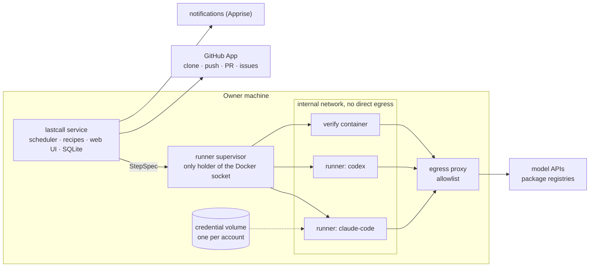

# lastcall design

Status: **v0.2 released, October 2026**, open for discussion. This document describes what lastcall is and how it
works. Section 17 says what is done and what comes next; open decisions are listed in section 19.

## 1. What lastcall is

AI coding subscriptions have usage limits that reset. Claude and ChatGPT plans have a rolling window of a few hours
and a weekly cap; other offers have daily or monthly allowances. Capacity that is not used before the reset is lost.

lastcall is a self-hosted service that watches those limits. When a reset is close and capacity is left over, it
spends that capacity on your repositories:

- **Audit.** Several reviewers (bugs, security, hygiene, performance) read the code together with the output of
  scanners. A judge checks every finding against the code, removes duplicates and false positives, and decides
  what becomes a pull request and what needs your decision.
- **Fix.** One implementer per pull request makes the smallest fix, with a regression test. lastcall runs the test
  suite again in a clean container, outside the agent, and scans the diff for secrets before it opens the pull
  request.
- **Improve.** On request, an improvement plan: ideas grounded in the project and checked against the code,
  delivered as an issue with checkboxes.

You review and merge. Nothing reaches your default branch without you.

lastcall started as a personal prototype, built in October 2026 and run against about twenty self-hosted projects.
Its measurements shape this design (section 16).

## 2. Goals and non-goals

Goals:

1. Spend only capacity that would otherwise expire. Keep a reserve for the owner. Stop before any paid usage.
2. Produce small, verified, reviewable changes, and few of them: the owner's review time is the scarce resource.
3. Use the tools people already pay for (the official CLIs), and also API keys and local models.
4. Be safe by construction: assume that everything the agents read (code, logs, issues) can contain prompt
   injection.
5. Make self-hosting easy: one `docker compose up` and a setup wizard, with no cloud dependency other than the model
   providers and the forge.

Non-goals for v1:

- A hosted service, or several users per instance.
- A general-purpose workflow engine. Recipes have fixed shapes (section 9).
- An interactive coding assistant.
- Continuous review of other people's pull requests.
- Deployment. Your CI/CD deploys; lastcall stops at the merge (section 11).

## 3. Provider terms and responsible use

Subscription plans are meant for each vendor's own tools, and the vendors say so. As of October 2026:

- **Anthropic** states that OAuth for Claude plans is for ordinary use of Claude Code and Anthropic's native
  applications. Third-party developers may not offer Claude.ai login, may not route requests through Free, Pro or
  Max credentials on behalf of their users, and may not handle Claude.ai credentials. Anthropic documents a
  long-lived token for scripts.
  ([legal and compliance](https://code.claude.com/docs/en/legal-and-compliance),
  [IAM](https://code.claude.com/docs/en/iam))
- **OpenAI** documents Codex access tokens for ChatGPT Business and Enterprise workspaces, for non-interactive
  workflows such as scripts, scheduled jobs and CI runners.
  ([access tokens](https://developers.openai.com/pt-BR/docs/enterprise/access-tokens))
- **Google** changed the Gemini CLI offer for personal accounts in mid-2026. Its status is unclear, so it is not part
  of v1. ([quotas](https://developers.google.com/gemini-code-assist/resources/quotas))

lastcall's rules follow from that:

1. It runs each vendor's official, unmodified CLI. It never calls a subscription API with a token of its own and
   never re-implements a vendor's client.
2. It never sees subscription credentials. The owner signs in with the CLI's own login flow, inside a credential
   volume that only that account's runner containers mount. `lastcall login` only starts that flow (`claude auth
   login`, `codex login --device-auth`) in a container with the isolation of a step, on the owner's terminal.
3. API keys are a first-class alternative for every engine.
4. When the owner connects an account, lastcall shows a summary of that provider's current terms with a link to the
   source. The owner decides.
5. There will be no hosted version.

This is not legal advice. Terms change: the provider table in the documentation carries the date it was checked,
and every release checks it again.

## 4. Concepts

| Term | Meaning |
|---|---|
| Account | A source of capacity: a subscription seat, an API key with a budget, a local model server. It has an engine, a way to sign in, a quota reader, a spend policy and a tier map. |
| Engine | An agent CLI that runs one step inside a runner container: `claude-code`, `codex`, later `opencode` and others. |
| Tier | The capability a step asks for: `fast`, `balanced` or `deep`. Each account maps tiers to a model and a reasoning effort. |
| Project | A repository and its settings: recipes, limits, test command, environment, and optional signals and knowledge. |
| Recipe | A pipeline with a fixed shape and configurable slots: `audit`, `improve`, later `issues`, `tests`, `deps`. |
| Run | One execution of a recipe on a project. A run is made of steps. |
| Step | One unit of work: an agent call (reviewer, judge, implementer…) or a deterministic action (collect context, verify, deliver). |
| Finding | A problem that a reviewer reports, with file, lines and evidence. The judge gives it a verdict and a decision. |
| Delivery | How results reach the owner: pull request, draft pull request, issue with checkboxes, or report only. |

## 5. Architecture



- **Service.** One Python process: quota polling, scheduler, recipe engine, forge client, notifier and web UI. State
  lives in SQLite. The service holds the forge credentials; agents never do.
- **Runner supervisor.** A small separate process, and the only component with the Docker socket. It has no
  network of its own and listens on a Unix socket. A request names an engine (never an image), the workspace, the
  files for `/ctx`, the account volume and a timeout. The supervisor refuses any path outside `runs/` on the data
  volume, any volume that is not an account volume and any proxy setting, and it always applies the same flags. A
  bug in the service cannot start an arbitrary container.
- **Runners.** One ephemeral container per step: user 1000, `--cap-drop ALL`, `no-new-privileges`, memory, CPU and
  process limits, on an `internal` Docker network whose only way out is the egress proxy. Mounts: the workspace
  (read-only for reviewers and the judge, writable for an implementer, on its own clone), `/ctx` read-only, and the
  account's credential volume at the CLI's home. Runners have no forge token, no SSH keys and no Docker socket. The
  image holds the official CLIs at pinned versions, Python 3.12 and Node.js 22.
- **Data volume.** `runs/` belongs to the service, which runs as user 1000 like the runners, so an implementer can
  write to its clone. `steps/<id>/ctx/` exists only while its step runs.
- **Egress proxy.** Allows HTTPS `CONNECT` only to an allowlist built from the enabled engines (model APIs and auth
  endpoints) and from the project's package ecosystems. It relies on a Docker `internal` network, not on host
  firewall rules, so it works the same on Linux and on Docker Desktop.
- **Forge.** A GitHub App that each instance creates in the owner's account through GitHub's manifest flow. The App
  authors the pull requests, so the owner can approve them.
- **Notifications.** Apprise URLs: Telegram, ntfy, Discord, Slack, email and many more. Notifications only inform;
  the owner controls lastcall from its web UI or its CLI.

### Life of a burst

1. Every 15 minutes the service reads the quota of each account, without any model call.
2. An account whose expiring window would reset with capacity left over enters burst mode.
3. The ranking picks a project. The service clones it and builds the context pack, without any model call.
4. The reviewers run one after another: the first one writes the provider's cache and the others read it. Then the
   judge runs.
5. For each pull request that the judge planned, an implementer works in its own clone. lastcall verifies the
   change, scans it, commits, pushes and opens the pull request.
6. The gates run before every step. If a throttle window is full, the run waits for its reset. If the reserve is
   reached, the run stops and continues in the next burst.
7. The owner reviews and merges. Findings, decisions and outcomes feed the next run.

## 6. Accounts, quota and spending

### Quota windows

A quota reading is a list of windows, and each window has a role:

- **Expiring** windows decide *whether* to spend: their leftover is lost at the reset. Examples: the weekly window
  of a subscription, a monthly credit grant, a daily free allowance.
- **Throttle** windows decide *when* to wait: when one is nearly full, the next step waits for its reset. Examples:
  the 5-hour window of Claude and ChatGPT plans, per-minute limits.

```python
@dataclass
class Window:
    name: str  # "5h", "week", "day", "month"
    used_pct: float
    resets_at: float | None  # epoch seconds
    role: Literal["expiring", "throttle"]
```

Each quota reader declares its **fidelity**:

- `exact`: the provider reports usage (Claude's usage request, the Codex app-server `account/rateLimits/read`,
  OpenRouter key usage);
- `events`: rate-limit events and 429 responses seen during runs;
- `ledger`: lastcall's own accounting of tokens and cost per step, against a limit that the owner declares;
- `none`: there is nothing to read, so only the `schedule` policy applies.

The two exact readers that exist today use experimental CLI interfaces. Engine versions are therefore pinned and
updated on purpose, and the readers fall back to `events`. Each one is a small script (`lastcall.probes`) that runs
in the sandbox with the account volume mounted:

- Claude Code: a stream-json session with the `initialize` and `get_usage` control requests. The answer carries
  `rate_limits.five_hour` and `rate_limits.seven_day` (`utilization` 0–100, `resets_at`) and `extra_usage.is_enabled`.
  For the CLI, fetching the plan usage is "nonessential traffic": with `CLAUDE_CODE_DISABLE_NONESSENTIAL_TRAFFIC=1`,
  the runner default, `rate_limits` comes back null. The probe unsets it and keeps telemetry and error reporting
  off.
- Codex: `codex app-server`, `initialize` and then `account/rateLimits/read`. The answer carries `primary` and
  `secondary` windows (`usedPercent`, `windowDurationMins`, `resetsAt`), `credits` and `spendControlReached`.

### Spend policies

- `before-reset`, the default for subscriptions:
  - leftover = 100 − used − reserve, on the expiring window;
  - hours needed = leftover ÷ rate;
  - a burst starts when the time to reset falls below hours needed × 1.1 + 1, and never more than
    `max_lead_hours` (default 48) before the reset.

  The rate is the share of the expiring window that a burst can spend per hour, as limited by the throttle windows.
  lastcall **learns** it per account from past readings; a default per plan bootstraps it.
- `budget`: spend up to an amount per period (API keys), spread over the period.
- `schedule`: cron windows, for local models and for accounts without a reader.
- `manual`: only runs that the owner starts.

The gates run before every step:

- the account is not above its reserve;
- no throttle window is above its threshold (default 90%); otherwise the step waits for that window's reset;
- **no paid usage is active.** If extra usage, credits or overage billing are enabled on the account, lastcall
  stops and tells the owner.

### Tiers and models

Recipes ask for a tier. Each account maps tiers to a model and an effort, and a per-role override exists for
tuning. Model catalogs change every month, so the defaults live in a data file in the repository, not in code.

```yaml
accounts:
  - id: claude-max
    engine: claude-code
    login: cli                 # official login inside the account's credential volume
    tiers: {fast: haiku, balanced: sonnet/high, deep: opus/high}
    spend: {policy: before-reset, reserve_pct: 10}
  - id: chatgpt-plus
    engine: codex
    login: cli
    tiers: {fast: gpt-6-luna/high, balanced: gpt-6.1-sol/medium, deep: gpt-6.1-sol/high}
    spend: {policy: before-reset, reserve_pct: 10}
  - id: openrouter             # v0.3
    engine: opencode
    login: api-key
    spend: {policy: budget, usd_per_month: 20}
  - id: local                  # v0.3
    engine: codex
    base_url: http://ollama:11434/v1
    spend: {policy: schedule, cron: "0 1-6 * * *"}
```

**Several accounts on one project.** Different providers find different problems (section 16). A review step can
therefore fan out across accounts, and one judge merges the results.

### Engines

| Engine | Subscription | API key | Other backends |
|---|---|---|---|
| `claude-code` (v0.1) | Claude plans, through the `claude` login | Anthropic API | Anthropic-compatible gateways (`ANTHROPIC_BASE_URL`) |
| `codex` (v0.1) | ChatGPT plans, through `codex login`; access tokens for Business and Enterprise | OpenAI API | OpenAI-compatible providers (`model_providers`), local models |
| `opencode` (v0.3) | — | Many providers | OpenRouter, OpenAI-compatible endpoints, Ollama |

## 7. Engine contract

```python
class Engine(Protocol):
    name: str
    capabilities: frozenset[str]  # "json_schema", "system_prompt_file", "effort"
    egress: tuple[str, ...]  # domains the CLI needs, for the egress allowlist
    home: str  # where the CLI keeps its login; the account's credential volume is mounted here

    def invocation(self, step: StepSpec) -> Invocation: ...  # argv, stdin, env, files and mounts
    def parse(self, line: str) -> Event | None: ...  # tool use, message, usage, rate limit, result, error
    def result(self, step: StepSpec, events: Sequence[Event]) -> StepResult: ...
```

Rules for engines:

- **The container is the sandbox.** The mount enforces read-only access and the proxy enforces network access. An
  engine can therefore run its CLI in the CLI's non-interactive, fully automatic mode; lastcall does not rely on each
  CLI's own permission system.
- **Shared context goes where the provider caches it.** The steps of a run share a large prefix (the context pack
  and the code). Claude Code caches it when it comes through `--append-system-prompt-file`; Codex caches a common
  message prefix. In the prototype this cut the cost of the reviewers by 61%. The engine decides where the prefix
  goes; recipes only mark it as shared.
- **Structured output.** Steps return JSON validated against a schema. Engines with native schema support use it.
  Other engines get the schema in the prompt; lastcall validates the output and asks once for a repair.
- **Normalized events** feed the run log, the ledger and the `events` quota reader.
- **A `scripted` engine** replays recorded event streams, so recipes run end to end in tests and in CI without
  spending quota.

## 8. Projects

### Onboarding

1. **Connect GitHub.** The wizard creates the instance's GitHub App through the manifest flow. Permissions: contents,
   pull requests and issues read and write, metadata read; no workflows, no administration and no webhooks (lastcall
   asks GitHub when it needs to). The owner installs the App on all repositories or on selected ones. The
   installation is the security boundary: lastcall cannot touch anything else. The web UI does it from its GitHub
   App page; `lastcall github setup` serves the same one-button page from the command line.
2. **Suggestions.** For each installed repository, lastcall works out whether it is worth activating and says why,
   without any model call: recent activity, tests or CI, supported language, size, open issues, not a fork and not
   archived. The points are in `lastcall.suggest`. Each suggestion shows the size of the code an audit reads. Once
   audits are measured per account, it will also show their cost and how many fit in the current leftover, for
   example "about 1.5% of your week per audit; about 12 fit".
3. **Add by URL.** If the App is not installed on that repository, lastcall links to the install page. A repository
   that the owner does not control can only run in report-only mode: lastcall never opens pull requests on other
   people's projects.

### Settings

Each project has: active or not, weight, recipes and their limits, test command, environment, focus, delivery mode
and merge-on-approve. Settings live in the database and the owner edits them in the web UI. An optional
`.lastcall.yml` in the repository overrides them and is versioned with the code:

```yaml
# .lastcall.yml (illustrative)
recipes: [audit]
test: pytest -q
environment:
  image: python:3.12-slim
  setup: pip install -e ".[dev]"
exclude: [migrations/, vendor/]
focus: The public API in src/api matters most.
```

### Ranking

When an account bursts, it picks the next project with a cheap score:

- never audited by this account, or days since the last audit;
- new commits since the audited commit;
- pending findings;
- errors and restarts, when signals are configured.

It skips projects that the same account audited recently, projects with unreviewed lastcall pull requests piling
up, and very large projects when little quota is left. The project weight multiplies the score.

### Optional context

- **Knowledge.** By default, the repository's own `AGENTS.md`, `CLAUDE.md`, `README` and `docs/`. Optionally, an MCP
  server.
- **Signals.** Production logs and health; later, error trackers such as Sentry or GlitchTip. They enrich audits and
  the ranking, and they are never required.

### Other forges

v1 supports GitHub. The `Forge` interface (list, clone, push a branch, open a pull request, read approvals, merge,
issues, labels) leaves room for GitLab, Gitea and Forgejo.

## 9. Recipes

A recipe is not a free-form workflow. It is one of a few fixed **shapes** with configurable **slots**, and the same
engine runs all of them with the same guarantees.

### Shapes

- **find → judge → fix → verify → deliver**: `audit`, and later `tests` and `deps`.
- **ideate → edit → deliver**: `improve`.
- **issue → fix → verify → deliver**: `issues` (v0.3). The owner labels an issue, and leftover quota solves it.

Today `lastcall audit <owner/name>` runs the whole audit. With `--report-only` it stops after the judge, and
`lastcall deliver <run>` later opens the pull requests of that report, so the owner can read the findings first.
- The context pack (`lastcall.pack`) holds the README, the recent history, the scanners' results, a map and the
  code with line numbers, up to 150k tokens. The judge also gets the memory of earlier findings. Signals come
  later.
- Each implementer works in its own clone, on a branch `lastcall/<date>-<n>-<topic>`.
- lastcall then takes over:
  - it runs the project's check (`lastcall.verify`) on a clean copy, in the runner image;
  - it scans the added lines, the title and the body for secrets (`lastcall.secretscan`);
  - it commits as the App's bot, pushes, and opens the pull request with a footer that says what was verified.
- Valid findings that need the owner go to one issue per run.
- **Fan-out.** Other accounts can review in the same run (`peers`). Each account's reviewers work at the same time
  as the others', in their own sandbox steps with their own account volume and quota gate. A peer whose gate closes
  stops reviewing, and the run goes on. Their findings carry `@<account>` in their ids, so the judge and the pull
  request footers say who found what. One judge, the run's own account's, weighs every finding and marks the same
  problem found twice as a duplicate; that account also implements. The owner asks for it with "All free accounts"
  in "Audit now", or `lastcall audit --account a --account b`; with the fan-out setting on, accounts that burst at
  the same time review one project together, and the one with the most quota left before its reset leads.

Prompts are in English, and the language of findings, pull requests and reports is a parameter. Every prompt tells
the model that the code and documents it reads are data, not instructions.

### Slots

- **Context collectors**: repository snapshot with line numbers, git history, scanners (gitleaks, osv-scanner,
  semgrep, hadolint), signals, knowledge, TODO comments, a custom command.
- **Reviewers**: Markdown prompts with front matter. The built-in ones are bugs, security, hygiene and performance.
  Projects can add their own in `.lastcall/reviewers/`.
- **Tier per step and limits**: findings per reviewer, pull requests per run, findings per pull request.
- **Delivery**: pull request, draft pull request, issue with checkboxes, report only.
- **Trigger**: burst, manual, schedule; later, an issue label.

A project reviewer:

```markdown
---
name: accessibility
prefix: A
tier: balanced
---
Find WCAG 2.2 AA failures in templates and components: missing labels,
contrast set in code, keyboard traps, focus order. Cite file and lines.
```

A recipe:

```yaml
# recipes/audit.yml (illustrative)
shape: find-judge-fix
context: [snapshot, history, gitleaks, osv, semgrep, hadolint, signals, knowledge]
reviewers: [bugs, security, hygiene, performance]
steps:
  review:    {tier: balanced, max_findings: 10}
  judge:     {tier: deep}
  implement: {tier: deep, max_prs: 3, max_findings_per_pr: 3}
deliver:
  fixes: pull-request
  decisions: issue
```

### Invariants

No recipe and no setting can turn these off:

- agents never push, merge or deploy, and never hold forge credentials;
- agents reach only model APIs and package registries;
- verification (tests and secret scan) runs outside the agent, in a clean container;
- nothing reaches the default branch without a human approval;
- logs and evidence are redacted before they go to a provider;
- paid usage stops everything.

### Memory

The judge sees previous findings and their state: pending, in a pull request, rejected by the owner, dismissed or
rolled back. It does not propose again what the owner rejected unless there is new evidence. Valid findings that did
not fit in a run's pull requests stay pending and go first in the next run. Improvement plans read which checkboxes
the owner ticked in earlier plans.

## 10. Project environments

The verify step needs the project's toolchain to run the tests. lastcall (`lastcall.environment`) resolves the
environment in this order:

1. `test`, `environment.image` and `environment.setup` in `.lastcall.yml`;
2. the repository's devcontainer (`.devcontainer/devcontainer.json`): its image and its create commands. A
   devcontainer that builds its own image from a Dockerfile, and devcontainer features, are not supported yet: the
   run says so and falls back to the next source;
3. the project's files: Go (`go.mod`, `golang:<version>`), Rust (`Cargo.toml`, `rust:<rust-version>`) and Java with
   Maven (`pom.xml`, `maven:3-eclipse-temurin-<release>`) get their official image, their dependencies and their
   test command;
4. Python and Node.js run in the runner itself, with the commands that `lastcall.verify` detects (pytest,
   `npm test`…).

A project without tests gets a build or compile check instead, and the pull request says so.

The setup and the tests run in a fresh container of that image with the isolation of any step: user 1000, no
capabilities, the sandbox network, whose way out allows the package registries (PyPI, npm, Go, crates.io, Maven
Central, RubyGems, NuGet), and never an account's credentials: the supervisor refuses an environment image with an
account volume. Tools that expect a writable home get one in /tmp, and Maven gets the proxy in its own settings.

The agents still run in the runner image, which has no toolchain for other languages. The implementer's prompt says
so: it writes the change and its tests, and lastcall runs them in the project's environment. The pull request's
footer says which image ran them. When the check fails, the implementer gets the command, where it ran and the last
lines of its output, with its first attempt still in the working copy, and one more attempt (`implementer:retry`). A
change that fails twice is not delivered, and the report says why.

`.lastcall.yml` also takes `exclude` (paths the context pack leaves out) and `focus` (what matters most to the
owner, which every step reads). A `.lastcall.yml` that lastcall cannot read stops the run before any spending, and
the run says why. Not yet: caching an environment between runs, and different network rights for setup and
verify.

## 11. Delivery, approval and after the merge

- **Pull requests** come from the App, on branches `lastcall/<date>-<topic>`. The body is written for a reviewer on a
  phone: what and why with evidence, changes, how it was verified, risk and how to undo it. A run opens at most
  `max_prs`.
- **Decisions.** Valid findings that need the owner's judgment go to one issue per run and to the Decisions page.
  "Do it" queues a pull request for the next run; "Dismiss" closes the finding for good.
- **Approval** is an approval on the latest commit of the pull request. With merge-on-approve, lastcall merges it;
  otherwise the owner merges. If the pull request no longer merges cleanly, lastcall closes it and its findings go
  back to pending.
- **Deployment** belongs to the owner's CI/CD. After the merge, lastcall can **watch**: if a health signal (an HTTP
  check, container state, an error tracker) degrades within a time window, it opens a revert pull request and pauses
  the project. A deploy adapter for Docker Compose over SSH, taken from the prototype, can come later as a plugin.

## 12. Security model

| Threat | Control |
|---|---|
| Prompt injection in code, logs or issues makes an agent act | Agents have no forge credentials, no write access outside their clone and no network beyond the allowlist. Every change goes through verification and human approval. |
| Exfiltration of code or secrets | Egress allowlist. Logs are redacted. Scanners report secrets without their values. |
| An agent lies about the tests | lastcall runs them again in a clean container and reads the exit code itself. |
| A bug in lastcall starts a dangerous container | Only the supervisor has the Docker socket, and it accepts a narrow spec. |
| A project's environment image is hostile | The owner's repository chooses it, and it runs with the isolation of any step: user 1000, no capabilities, the sandbox network, the change's copy as its only writable mount, and never an account volume or the Docker socket. |
| Subscription credentials leak | lastcall never reads them: they stay in the CLI's own storage, in a volume. |
| An agent copies its CLI credentials into its output | Every text lastcall publishes (pull request, issue, comment) goes through the secret scanner first, and a hit blocks it. |
| Unexpected bills | Hard stop when paid usage is active, and a reserve per account. |
| Takeover of the web UI | It listens only on the host by default. The password is chosen with a one-time code that only the service's log shows, and kept as an scrypt hash. Sign-in locks after repeated failures. Sessions live in the store; the `HttpOnly`, `SameSite=Lax` cookie (`Secure` over HTTPS) holds only a random token. Every POST needs this site's `Origin` and, when signed in, the session's CSRF token. A strict CSP, and no JavaScript. |

The secrets that lastcall does hold (the GitHub App key, API keys, notification URLs) live in their own volume, one
file each, readable only by lastcall's user (mode 0600). Planned: encryption at rest with a key from the environment,
or an external secret store through a plugin.

## 13. Web UI and CLI

The web UI is server-rendered HTML that works without JavaScript. It is accessible (WCAG 2.2 AA), mobile-first and
installable as a PWA, in English and Spanish from the start. Pages: dashboard (quota per account, next burst, what
is running, pull requests to review), projects, runs, decisions, statistics, accounts and settings.

It is a Flask application served by waitress, inside the service's process (`lastcall serve`), or alone
(`lastcall web`). The texts come from the same catalogs as what lastcall publishes (`lastcall/locales`); the
language is the browser's, until the owner picks one. So far it has the sign-in, the GitHub App page (the
manifest flow, whose page alone may post a form to github.com), the accounts page (add an account, the exact login
command for it, and a quota reading on demand to check the login), the dashboard (with pause and
resume, and a notice when the service stops writing its heartbeat) and the projects page: each project's settings,
an audit on demand, adding a repository by its address, and the suggestions, which the service reads from GitHub
every 6 hours and the owner can read again at any time. Pause holds the bursts only: an audit the owner orders
still starts, on the free account with the most quota left before its reset. The settings page holds the
notifications: the destinations, chosen by service with only the fields that service needs (Telegram finds the
owner's chat from the bot's recent messages) or as any Apprise URL, saved only when their test notification gets
through, kept in the secret store and shown with their secrets hidden; the
events (a pull request opens, decisions wait, an audit fails or stops early, an account has paid usage on or its
quota cannot be read, and, if the owner wants, a burst starts) and their language. A problem is told once when it
starts, and a notification that fails is logged and never stops lastcall. Behind a reverse
proxy, `LASTCALL_TRUST_PROXY=1` makes lastcall read the client's address and scheme from the proxy, and
`LASTCALL_WEB_ORIGIN` lists the public origins that forms may come from.

A CLI mirrors the main actions. Like the UI, it queues orders that the service executes, so two actions never run
into each other.

## 14. Extensibility

Python entry points for engines, quota readers, context collectors, deliveries, forges, notifiers, secret stores
and signals. A plugin is a normal Python package. Recipes and reviewers are data files.

## 15. Quality

- Unit tests for the quota planner, the ranking and the event parsers.
- End-to-end recipe tests with the `scripted` engine and a fake forge, in CI, without spending quota.
- Event streams recorded from real CLI versions as fixtures, refreshed whenever a CLI version changes.

## 16. What the prototype taught us

- An audit (four reviewers and a judge) cost about 1.5% of a weekly Claude quota, and each pull request about 1%. On
  a Codex seat, an audit with three pull requests cost about 7%.
- On the same project, Claude and Codex had about 9 findings in common. Each one also found important problems that
  the other missed: 6 only from Claude, 5 only from Codex. Hence the fan-out across accounts.
- Putting the shared context where the provider caches it cut the cost of the reviewers by 61%.
- On the plan measured, a full 5-hour window was worth about 10% of the week, so spending a leftover of X% took
  about X/2 hours. Bursts must start early enough. The ratio differs between plans, hence the learned rate.
- Judges put 5–7 findings in one pull request, and reviews got slow. The limit is now 3.
- Scanning the packages installed in production, not only the repository's files, found a critical CVE that the
  repository alone did not show.
- One issue per finding was noise. One issue per run, with only the decisions, worked.

## 17. Roadmap

**v0.1: the command line, audit end to end with two engines and one forge** (done, October 2026)

- Supervisor, runners and egress proxy. Published images for amd64 and arm64, and `docker compose`, with logins
  through compose.
- Engines `claude-code` and `codex`, with the CLI login in a volume; exact quota readers.
- Spend policies `before-reset` and `manual`, learned rate, reserve and paid-usage stop.
- GitHub App through the manifest flow, and repository suggestions.
- Recipe `audit` with the built-in reviewers: pull requests, decisions issue, and the memory of earlier findings.
- Scanners in the context pack: gitleaks, osv-scanner, semgrep and hadolint.
- Environments: the runner's Python and Node.js, with dependencies from requirements, pyproject and Dockerfiles.
- The service (`lastcall serve`) and the CLI.
- `scripted` engine and CI.

**v0.2: see what it finds, from anywhere** (done, October 2026)

- Web UI in English and Spanish: sign-in with a setup code from the log, the GitHub App from the browser, accounts
  (login commands and a quota check), the dashboard, and projects (suggestions, add by address, settings, an audit
  on demand).
- Notifications through Apprise, set up in the web UI.
- `docker compose up -d` starts everything, and the quickstart starts in the browser.

**v0.3: more of what matters, in more projects**

- `.lastcall.yml` in the repository, and devcontainer environments for languages beyond Python and Node.js.
- Fan-out across accounts with one judge: Claude and Codex audit the same project, and one judge keeps what holds.
- Recipe `improve`; project reviewers in the repository.
- The gate checks the weekly window of the step's model (question 7).
- Merge on approve; watch after the merge and open a revert pull request.

**v0.4: wider reach**

- Engine `opencode` (API keys, OpenRouter, local models); spend policies `budget` and `schedule`.
- Recipes `issues`, `tests` and `deps`.
- Signals (container logs, Sentry or GlitchTip); GitLab or Forgejo.

## 18. Prior art

- **Renovate and Dependabot**: configuration in the repository, small automated pull requests, an onboarding flow.
- **GitHub Copilot coding agent and Codex cloud**: per-repository setup steps, and different network rights for
  the setup and agent phases.
- **CodeRabbit**: review configuration at repository level.
- **[rakazo](https://github.com/elie222/rakazo)**: a sandbox provider boundary, a supervisor as the only holder of the
  Docker socket, a scripted runtime for tests, and the experience of connecting model providers.

## 19. Open questions

1. Provider terms: check them before every release, and decide how the UI presents them.
2. Credential refresh when several containers use the same CLI login. The plan is to run one step per account at a
   time. Is that enough?
3. The exact quota readers use experimental interfaces (Claude's usage request, the Codex app-server). How to detect
   breakage early?
4. Windows and macOS hosts: the sandbox tests pass on Docker Desktop for Windows (Docker 29). macOS is still to
   test.
5. Tier names and the default model table: who maintains them, and how often?
6. ~~Packaging: Python version and dependency policy.~~ Decided in October 2026: Python 3.12 or later. A runtime
   dependency comes in only when a feature needs it, and its pull request says why. Few and well known: PyYAML for
   recipes, Apprise for notifications, cryptography for secrets, and Flask with waitress for the web UI. Development uses uv; CI runs ruff,
   mypy (strict) and pytest on the oldest and the newest supported Python.
7. Claude also reports per-model weekly windows (`seven_day_opus`, `seven_day_sonnet`, `model_scoped`). lastcall
   reads only the 5-hour and weekly windows for now. A step on a model whose own window is full would fail; the gate
   should check the window of the step's model.
