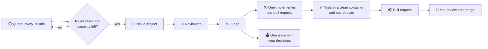

# lastcall ⏰

**Last call before your AI quota resets.**

[](https://github.com/ne0x86/lastcall/releases/latest)
[](https://github.com/ne0x86/lastcall/actions/workflows/ci.yml)
[](LICENSE)


Your AI subscriptions come with usage limits that reset, and whatever you do not use before the reset is gone.
lastcall watches those limits. When a reset is coming with capacity left over, it spends that capacity on your
repositories: it audits them, fixes what it can in small pull requests verified by your own tests, and leaves the
rest in an issue for you to decide. Nothing reaches your default branch without your approval. 🙌

It works through each vendor's official command-line tool, with your own login: today Claude Code and Codex. It can
also spend an API key with a monthly budget, or a local model at the hours you choose, through OpenCode. And
[more can plug in](#-engines).

## ✨ What it does

- 🔎 **Audits.** Four reviewers (bugs, security, hygiene, performance), and any that your repository adds, read your
  code. A judge checks every finding against the code and throws out the noise. Several accounts, even from
  different providers, can review the same project together, and one judge keeps what holds: each finds things the
  others miss.
- 🛠️ **Fixes.** One implementer per pull request writes the smallest fix, with a regression test.
- ✅ **Verifies.** lastcall, not the agent, runs your tests again in a clean container and scans the change for
  secrets.
- 📬 **Delivers.** Small pull requests from your own GitHub App, so you can approve them. Decisions it should not
  take go to one issue.
- 💡 **Improves.** When you ask, a plan of small improvements that fit your project, checked against the code: one
  issue with a checkbox per idea. lastcall builds the ones you tick, one pull request each.
- 🧪 **Writes tests, if you want.** For the behavior that matters and that no test checks: pull requests that add
  tests and change nothing else. lastcall refuses any change outside the tests.
- 🏷️ **Takes requests.** Label an issue `lastcall`, and a coming burst works on it: a pull request that closes the
  issue, or a comment on it that says what is missing. lastcall adds the label to your active repositories.
- 👀 **Merges and watches, if you want.** It merges the pull requests you approve once their checks pass, and it
  watches each merge for a day: when the checks or your health address break, it proposes a revert and pauses the
  project.
- 🧠 **Remembers.** It never proposes again what you rejected or dismissed, and it finishes what did not fit last
  time.
- ⏳ **Picks its moment.** It spends only capacity that would otherwise expire. It keeps a reserve for you and stops
  before any paid usage. An API key spends its monthly budget at the pace of the month, and a local model works at
  the hours of its schedule.
- 🖥️ **Shows you everything.** A dashboard in English and Spanish: what is left of every quota, the next burst, the
  pull requests to review and the decisions waiting for you.
- 🔔 **Tells you.** A notification when a pull request opens, a decision waits, an audit fails or an account needs
  you: Telegram, ntfy, Discord, Slack, email and many more, through Apprise.

<p align="center"></p>

## 🔁 How it works



**A real first run** on a small Python project, with a Claude Team seat:
- four reviewers and the judge took about 3 minutes and 0.56 USD-equivalent of the subscription; the weekly quota did
  not move;
- 11 findings, 7 confirmed;
- 3 pull requests with new tests, all green in a clean container.

## 🛡️ Safe by design

- 📦 Every agent step runs in a throwaway container: unprivileged, no capabilities, and the code read-only for
  reviewers.
- 🌐 The only way out is a proxy that allows the model API and package registries. No LAN, no GitHub, no other
  domain.
- 🔑 Agents never hold GitHub credentials and never push. lastcall does, after verifying.
- 🙈 Your subscription login stays in the official CLI's own storage. lastcall never reads it.
- 💳 An API key stays in lastcall's secret store, only the steps of its account get it, and its monthly budget caps
  what they cost. The local model server has no way out to the internet.
- 🧑‍⚖️ Nothing is merged without your approval, and a revert is only ever proposed.

## 🔌 Engines

lastcall drives each vendor's official command-line tool, with your own login, and OpenCode for API keys and local
models:

| Engine | Runs on | Quota it reads |
|---|---|---|
| Claude Code (`claude-code`) | Claude Pro, Max and Team | the 5-hour and weekly windows, and each model's own weekly window, exactly |
| Codex (`codex`) | ChatGPT Plus, Pro and Business | the 5-hour and weekly windows, exactly |
| OpenCode (`opencode`) | API keys of OpenRouter, Anthropic and OpenAI; local models on Ollama | what its steps cost this month, from lastcall's own ledger, against the budget you set |

An account on an API key needs no login: you give lastcall the key, a model and a monthly budget. OpenCode reports
what each step costs, with the prices of [models.dev](https://models.dev), and lastcall stops when this month's
steps have cost the budget. A step that is already running may go a little over it, so give the key its own
spending limit at the provider too.

The rest of lastcall only knows the engine contract. Adding another tool is one module and a few small changes:
[CONTRIBUTING.md](CONTRIBUTING.md#adding-an-engine) lists them.

## 🚀 Quickstart

You need Docker 26 or later and a GitHub account. It runs on Linux, macOS, and Windows with Docker Desktop.

**1. Start lastcall:**

```sh
git clone --branch v0.4.0 https://github.com/ne0x86/lastcall && cd lastcall
docker compose up -d
```

**2. Open http://127.0.0.1:8080** 🖥️ and choose your password. To show that the instance is yours, copy the setup
code from the log:

```sh
docker compose logs lastcall        # Web UI setup code: XXXX-XXXX
```

**3. Follow the dashboard.** It walks you through the rest:

- 🐙 **GitHub App.** One click creates it, private to you. Then install it on the repositories lastcall may work on.
- 🤖 **Accounts.** Add each AI subscription that lastcall may use, and sign it in with its tool's own official
  login. lastcall never sees it:

  ```sh
  ACCOUNT=claude-max ENGINE=claude-code docker compose run --rm login   # Claude: paste the code back
  ACCOUNT=chatgpt ENGINE=codex docker compose run --rm login            # Codex: a device code
  ```

  On PowerShell: `$env:ACCOUNT="claude-max"; $env:ENGINE="claude-code"; docker compose run --rm login`.

  An API key or a local model needs no login: the Accounts page asks for the key, the model and a monthly budget,
  or a schedule, with links to where each one comes from. A local model runs on the Ollama server that comes with
  lastcall, which has no way out to the internet; models come in only through `ollama-pull`:

  ```sh
  docker compose --profile local up -d ollama                      # the model server
  docker compose --profile local run --rm ollama-pull qwen3-coder  # a model, about 19 GB: a graphics card helps
  ```
- 📁 **Projects.** lastcall suggests your repositories and says why. Add the ones you want, or any by its address.
- 🔔 **Settings.** Where lastcall should notify you. Choose the service and fill in what it asks for: Telegram (paste
  your bot's token and lastcall finds your chat), ntfy, Discord, Slack or email, or any of the
  [services that Apprise reaches](https://github.com/caronc/apprise#supported-notifications). lastcall saves a
  destination only once its test notification gets through.

That is all. When a reset comes with capacity left, lastcall bursts on its own, and the dashboard shows what it
does. Pause it from the dashboard at any time, or start an audit or an improvement plan yourself from the Projects
page.

The web UI listens only on this machine. To open it from elsewhere, put a reverse proxy with HTTPS in front of it
and set `LASTCALL_TRUST_PROXY=1`.

To upgrade, check out the new release and pull its images; your settings and history stay in Docker volumes:

```sh
git fetch --tags && git checkout v0.4.0      # the release you want
docker compose pull && docker compose up -d
```

<details>
<summary>Prefer the terminal? Everything works from the command line too.</summary>

```sh
docker compose run --rm -p 127.0.0.1:8765:8765 cli github setup --owner <your-github-login>
docker compose run --rm cli account add claude-max --engine claude-code --language English
docker compose run --rm cli account add openrouter --engine opencode --provider openrouter \
  --model <model> --budget 20                                  # asks for the key; or --key-file - with -T
docker compose run --rm cli account add local --engine opencode --provider ollama \
  --model qwen3-coder --policy schedule --schedule "* 1-6 * * *"   # every night, 01:00 to 06:59 UTC
docker compose run --rm cli quota claude-max
docker compose run --rm cli github repos
docker compose run --rm cli project add <owner/name>
docker compose run --rm cli audit <owner/name> --account claude-max --report-only   # findings only
docker compose run --rm cli deliver <run> --account claude-max                       # then the pull requests
docker compose run --rm cli improve <owner/name> --account claude-max                # a plan; then the ideas you tick
docker compose run --rm cli issues <owner/name> --account claude-max                 # labelled issues, now
docker compose run --rm cli tests <owner/name> --account claude-max                  # tests for what none checks
docker compose run --rm cli status                                                   # accounts, bursts, findings
docker compose run --rm cli pause                                                    # or resume
```

</details>

## ⚙️ Your project's settings

lastcall verifies every change by running your tests again in a clean container. It finds the environment on its
own for Python and Node.js, and for Go (`go.mod`), Rust (`Cargo.toml`) and Java with Maven (`pom.xml`), which run in
their official images. A devcontainer with an `image` works too. For anything else, or to change what it found, add
a `.lastcall.yml` to the root of your repository:

```yaml
test: go test ./...              # the command that runs your tests
environment:
  image: golang:1.23             # where the setup and the tests run
  setup: go mod download         # before the tests: a command, or a list of them
exclude: [vendor/, testdata/]    # paths the audit leaves out
focus: The HTTP handlers in internal/api matter most.
reviewers: [bugs, security, accessibility]   # the reviewers a run takes; all of them when left out
```

Every key is optional. The suggestions on the Projects page say which repositories bring their own environment.

**Your own reviewers.** Each Markdown file in `.lastcall/reviewers/` adds a reviewer to the audits of your
repository, next to bugs, security, hygiene and performance. The front matter gives its name (lowercase letters,
digits and dashes), the prefix of its findings (`A` makes them A1, A2...) and its tier (`fast`, `balanced` or
`deep`, the model it runs on); the text after it says what to look for:

```markdown
---
name: accessibility
prefix: A
tier: balanced
---
Find WCAG 2.2 AA failures in templates and components: missing labels,
contrast set in code, keyboard traps, focus order. Cite file and lines.
```

A repository can have up to 4 reviewers of its own, of 8 KB at most each. A wrong one stops the run before it
spends anything, and the run says why.

**Tests too.** On the Projects page, each project can also get tests: every other burst on it writes tests for
the behavior that no test checks, instead of an audit. "Write tests now" starts one at once.

**After the merge.** Two settings of each project, on the Projects page, are off until you turn them on. They live
in lastcall only, never in `.lastcall.yml`, so that nobody can turn them on from a pull request:
- **Merge after my approval.** When you, a member or a collaborator approves the latest commit of a lastcall pull
  request on GitHub, and no check fails or is still running, lastcall merges it. If it no longer merges cleanly,
  lastcall closes it, and the change comes back in a later run, on the current code.
- **Watch after the merge.** For a day after a merge, lastcall looks at the checks of the merged commit and, if you
  give one, at a health address every 10 minutes. When the checks fail where they passed before, or the address
  fails 3 times in a row, it opens a pull request that reverts the change, pauses the project and tells you.

## ⚖️ Provider terms and responsible use

Subscription plans are meant for each vendor's own tools. lastcall follows these rules:
- it runs each vendor's **official, unmodified CLI**;
- it never handles your subscription credentials;
- it never offers a hosted version.

API keys and local models are the alternative: OpenCode runs on them, under each provider's API terms. Read the
current terms of your provider before you connect an account;
[DESIGN.md](DESIGN.md#3-provider-terms-and-responsible-use) has the details and the sources. This is not legal
advice.

## 🗺️ Roadmap

- ✅ **v0.1, command line.**
  - The whole audit: find, judge, fix, verify, deliver.
  - Engines: Claude Code and Codex. Forge: GitHub.
  - Memory of findings, and the service that bursts on its own.
  - Scanners in the context pack: gitleaks, osv-scanner, semgrep and hadolint.
- ✅ **v0.2, web UI.**
  - Setup from the browser, dashboard, projects and accounts, in English and Spanish.
  - Notifications: Telegram, ntfy, Discord, email and more.
- ✅ **v0.3, more projects, more eyes.**
  - `.lastcall.yml` in your repositories, devcontainer images, and Go, Rust and Java out of the box.
  - A second attempt at a fix when the project's check fails, with the check's output.
  - Fan-out: several accounts, even from different providers, audit the same project, and one judge keeps what
    holds.
  - Engines are plug-ins: one module each, and one login command for all of them.
- ✅ **v0.4, closer to the merge.**
  - Reviewers that your repository defines.
  - The `improve` recipe: plans of small improvements, and pull requests for the ideas you tick.
  - Merge on approve; watch after the merge and propose a revert.
  - The gate checks the weekly window of each model.
- 🔜 **v0.5, wider reach.**
  - ✅ API keys and local models: OpenCode on OpenRouter, Anthropic, OpenAI and Ollama, with a monthly budget or a
    schedule.
  - ✅ The `issues` recipe: label an issue `lastcall`, and it becomes a pull request.
  - ✅ The `tests` recipe: tests for what no test checks, in pull requests that change only tests.
  - The `deps` recipe: dependency upgrades that need more than a new version number.
  - GitLab and Forgejo.

## 🧑‍💻 Development

You need [uv](https://docs.astral.sh/uv/) and Docker.

```sh
uv sync                                     # the environment
uv run pytest                               # unit tests
uv run ruff check && uv run ruff format --check && uv run mypy
```

To build every image from your checkout and run the sandbox tests against the real containers, use the dev override
(on Windows the separator is `;`):

```sh
export COMPOSE_FILE=compose.yaml:compose.dev.yaml
docker compose --profile build --profile cli --profile test build
docker compose --profile test run --rm it
```

A release sets the version in three places that a test keeps in agreement: `__version__`, the image tag in
`compose.yaml` and the tag that the quickstart clones. How it all fits together: [DESIGN.md](DESIGN.md).

## 🤝 Contributing

Issues and pull requests are welcome: [CONTRIBUTING.md](CONTRIBUTING.md) explains how, including how to add an
engine. Please report security problems privately, as [SECURITY.md](SECURITY.md) says. Everyone who takes part
follows the [code of conduct](CODE_OF_CONDUCT.md).

## 📄 License

[Apache-2.0](LICENSE)
