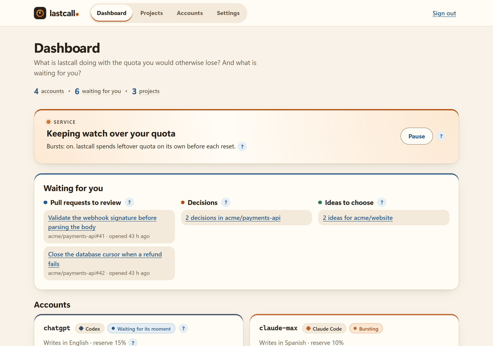
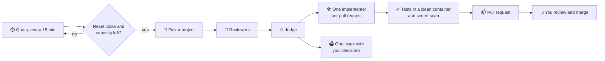

# lastcall ⏰

**Last call before your AI quota resets.**

[](https://github.com/ne0x86/lastcall/releases/latest)
[](https://github.com/ne0x86/lastcall/actions/workflows/ci.yml)
[](LICENSE)


Your AI subscriptions come with usage limits that reset, and whatever you do not use before the reset is gone.
lastcall watches those limits. When a reset is coming with capacity left over, it spends that capacity on your
repositories: it audits them, fixes what it can in small pull requests verified by your own tests, and leaves the
rest in an issue for you to decide. Nothing reaches your default branch without your approval. 🙌

It works through each vendor's official command-line tool, with your own login: today Claude Code and Codex. It can
also spend an API key with a monthly budget, or a local model at the hours you choose, through OpenCode. And
[more can plug in](#-engines).

## ✨ What it does

- 🔎 **Audits.** Four reviewers (bugs, security, hygiene, performance), and any that your repository adds, read your
  code. A judge checks every finding against the code and throws out the noise. Several accounts, even from
  different providers, can review the same project together, and one judge keeps what holds: each finds things the
  others miss.
- 🛠️ **Fixes.** One implementer per pull request writes the smallest fix, with a regression test.
- ✅ **Verifies.** lastcall, not the agent, runs your tests again in a clean container and scans the change for
  secrets.
- 📬 **Delivers.** Small pull requests from your own GitHub App, so you can approve them. Decisions it should not
  take go to one issue.
- 💡 **Improves.** When you ask, a plan of small improvements that fit your project, checked against the code: one
  issue with a checkbox per idea. lastcall builds the ones you tick, one pull request each.
- 🧪 **Writes tests, if you want.** For the behavior that matters and that no test checks: pull requests that add
  tests and change nothing else. lastcall refuses any change outside the tests.
- 📦 **Upgrades dependencies, if you want.** The upgrades that need more than a new version number: a known
  vulnerability, a deprecated package, a major version behind. It changes the code that the new version breaks, and
  your tests check it.
- 🚨 **Reads your errors, if you want.** From Sentry or GlitchTip, from the logs of your containers on the same
  machine, or from Grafana Loki for your other machines: the audits look for the cause of the most frequent errors
  first, and projects with errors in the last day go first.
- 🏷️ **Takes requests.** Label an issue `lastcall`, and a coming burst works on it: a pull request that closes the
  issue, or a comment on it that says what is missing. lastcall adds the label to your active repositories.
- 👀 **Merges and watches, if you want.** It merges the pull requests you approve once their checks pass, and it
  watches each merge for a day: when the checks or your health address break, it proposes a revert and pauses the
  project.
- 🧠 **Remembers.** It does not propose again what you rejected or dismissed unless it finds new evidence, and it
  finishes what did not fit last time.
- ⏳ **Picks its moment.** On its own, it spends only capacity that would otherwise expire. It keeps a reserve for
  you and stops before any paid usage. An API key spends its monthly budget at the pace of the month, and a local
  model works at the hours of its schedule.
- 🖥️ **Shows you everything.** A dashboard in English and Spanish: what is left of every quota, the next burst, the
  pull requests to review and the decisions waiting for you. A "?" next to anything unclear explains it.
- 🔔 **Tells you.** A notification when a pull request opens, a decision waits, an audit fails or an account needs
  you: Telegram, ntfy, Discord, Slack, email and many more, through Apprise.

<p align="center"></p>

## 🔁 How it works



**A real first run** on a small Python project, with a Claude Team seat:
- four reviewers and the judge took about 3 minutes and 0.56 USD-equivalent of the subscription; the weekly quota did
  not move;
- 11 findings, 7 confirmed;
- 3 pull requests with new tests, all green in a clean container.

## 🛡️ Safe by design

- 📦 Every agent step runs in a throwaway container: unprivileged, no capabilities, and the code read-only for
  reviewers.
- 🌐 The only way out is a proxy with a short allowlist: the model APIs and their logins, the package registries,
  and the services that lastcall's own tools use (vulnerabilities, latest versions, model prices). No LAN, no
  GitHub, nothing else: [egress/filter](egress/filter) holds the list.
- 🔑 Agents never hold GitHub credentials and never push. lastcall does, after verifying.
- 🙈 Your subscription login stays in the official CLI's own storage. lastcall never reads it.
- 💳 An API key stays in lastcall's secret store, only the steps of its account get it, and its monthly budget caps
  what they cost. The local model server has no way out to the internet.
- 🚨 What comes from production reaches the models masked, without emails, addresses, tokens or long numbers. From a
  tracker, an error's type, its message and the lines of your code, never its variables, request or user data; from
  logs, one sample line of each kind of error. lastcall reads the logs of a container, or of a source in Loki, only
  after you give it a project.
- 🧑‍⚖️ Nothing is merged without your approval, and a revert is only ever proposed.

## 🔌 Engines

lastcall drives each vendor's official command-line tool, with your own login, and OpenCode for API keys and local
models:

| Engine | Runs on | Quota it reads |
|---|---|---|
| Claude Code (`claude-code`) | Claude Pro, Max and Team | the 5-hour and weekly windows, and each model's own weekly window, exactly |
| Codex (`codex`) | ChatGPT Plus, Pro and Business | the 5-hour and weekly windows, exactly |
| OpenCode (`opencode`) | API keys of OpenRouter, Anthropic and OpenAI; local models on Ollama | what its steps cost this month, from lastcall's own ledger, against the budget you set |

An account on an API key needs no login: you give lastcall the key, a model and a monthly budget. OpenCode reports
what each step costs, with the prices of [models.dev](https://models.dev), and lastcall stops when this month's
steps have cost the budget. A step that is already running may go a little over it, so give the key its own
spending limit at the provider too.

**Models and effort.** Every step asks for a tier: the reviewers for *balanced*; the judge, the implementers and the
improvement plans for *deep*; your repository's own reviewers for the one they name. Each engine has a default
model and effort per tier, such as opus at `high` effort for Claude Code's *deep*. On the Accounts page, under
*Models and effort*, or with `lastcall account tier`, you can change both for one account, subscriptions included.
More effort finds more, and spends more of the quota.

The rest of lastcall only knows the engine contract. Adding another tool is one module and a few small changes:
[CONTRIBUTING.md](CONTRIBUTING.md#adding-an-engine) lists them.

## 🚀 Quickstart

You need Docker 26 or later, a GitHub account, and something for lastcall to spend: a Claude or ChatGPT subscription, an
API key or a local model. It runs on Linux and on Windows with Docker Desktop. On macOS with Docker Desktop it should
work, but it has not been tested yet.

**1. Start lastcall:**

```sh
git clone --branch stable https://github.com/ne0x86/lastcall && cd lastcall   # the latest release
docker compose up -d
```

**2. Open the web UI** 🖥️ at http://127.0.0.1:8080, or at your server's address if you set `LASTCALL_BIND`
([On a server](#-on-a-server)), and choose your password. The `Web UI on …` line of the log says which address Docker
publishes. To show that the instance is yours, copy the setup code from the log:

```sh
docker compose logs lastcall        # Web UI setup code: XXXX-XXXX
```

**3. Follow the dashboard.** Its Getting started card walks you through three steps, GitHub App, Accounts and
Projects, and Settings holds a fourth that is optional:

- 🐙 **GitHub App.** Say whose repositories they are (your username or an organization: lastcall asks GitHub which), and
  one click creates the App, private to that account. You must be signed in to github.com as that account, or, for an
  organization, be one of its owners or allowed to manage its GitHub Apps. Then install it on the repositories lastcall
  may work on.
- 🤖 **Accounts.** Add each AI subscription that lastcall may use, and sign it in with its tool's own official
  login. lastcall never sees it:

  ```sh
  ACCOUNT=claude-max ENGINE=claude-code docker compose run --rm login   # Claude: paste the code back
  ACCOUNT=chatgpt ENGINE=codex docker compose run --rm login            # Codex: a device code
  ```

  On PowerShell: `$env:ACCOUNT="claude-max"; $env:ENGINE="claude-code"; docker compose run --rm login`.

  An API key or a local model needs no login: the Accounts page asks for the key, the model and a monthly budget,
  or a schedule, with links to where each one comes from. A local model runs on the Ollama server that comes with
  lastcall, which has no way out to the internet; models come in only through `ollama-pull`:

  ```sh
  docker compose --profile local up -d ollama                      # the model server
  docker compose --profile local run --rm ollama-pull qwen3-coder  # a model, about 19 GB: a graphics card helps
  ```
- 📁 **Projects.** lastcall suggests your repositories and says why. Add the ones you want, or any by its address.
- 🔔 **Settings.** Where lastcall should notify you. Choose the service and fill in what it asks for: Telegram (paste
  your bot's token and lastcall finds your chat), ntfy, Discord, Slack or email, or any of the
  [services that Apprise reaches](https://github.com/caronc/apprise#supported-notifications). lastcall saves a
  destination only once its test notification gets through. The same page can also read your apps' errors, if you
  want: from Sentry or GlitchTip, your containers' logs or Loki (see *Your project's settings* below).

That is all. When a reset comes with capacity left, lastcall bursts on its own, and the dashboard shows what it
does. Pause it from the dashboard at any time: Pause holds the bursts only, so an audit, tests, upgrades or an
improvement plan that you start yourself from the Projects page still runs. Choose the language of the pages in
Settings.

The web UI listens only on this machine. To run lastcall on a server and reach it from elsewhere, see
[On a server](#-on-a-server); to move to a new release, [Updating](#-updating).

<details>
<summary>Prefer the terminal? Everything works from the command line too.</summary>

```sh
docker compose run --rm -p 127.0.0.1:8765:8765 cli github setup --owner <your-login-or-organization>
docker compose run --rm cli account add claude-max --engine claude-code --language English
docker compose run --rm cli account add openrouter --engine opencode --provider openrouter \
  --model <model> --budget 20                                  # asks for the key; or --key-file - with -T
docker compose run --rm cli account add local --engine opencode --provider ollama \
  --model qwen3-coder --policy schedule --schedule "* 1-6 * * *"   # every night, 01:00 to 06:59 UTC
docker compose run --rm cli quota claude-max
docker compose run --rm cli account tier claude-max deep --effort max                # the judge and fixes, at max
docker compose run --rm cli github repos
docker compose run --rm cli project add <owner/name> --signals <its project in Sentry or GlitchTip>
docker compose run --rm cli signals connect --url https://sentry.io --org <slug>     # asks for the token
docker compose run --rm cli signals show <owner/name>                                # its errors, as audits read them
docker compose run --rm cli logs list                                                # containers, with suggestions
docker compose run --rm cli logs set <container> <owner/name>                        # read it for that project
docker compose run --rm cli logs show <owner/name>                                   # the errors in their logs
docker compose run --rm cli loki connect --url http://<host>:3100                    # Loki, on other machines
docker compose run --rm cli loki list                                                # its sources, with suggestions
docker compose run --rm cli loki set <source> <owner/name>                           # read it for that project
docker compose run --rm cli loki show <owner/name>                                   # the errors in its sources
docker compose run --rm cli audit <owner/name> --account claude-max --report-only   # findings only
docker compose run --rm cli deliver <run> --account claude-max                       # then the pull requests
docker compose run --rm cli improve <owner/name> --account claude-max                # a plan; then the ideas you tick
docker compose run --rm cli issues <owner/name> --account claude-max                 # labelled issues, now
docker compose run --rm cli tests <owner/name> --account claude-max                  # tests for what none checks
docker compose run --rm cli deps <owner/name> --account claude-max                   # upgrades with code changes
docker compose run --rm cli status                                                   # accounts, bursts, findings
docker compose run --rm cli pause                                                    # or resume
```

</details>

## 🌍 On a server

lastcall runs the same on a server as on your computer. Its web UI listens only on the server itself
(`127.0.0.1:8080`), so nobody else reaches it until you choose how. On Linux, that needs Docker 28.3.3 or later:
older versions can let machines on the same local network reach ports published on `127.0.0.1`.

The `Web UI on …` line of the log (`docker compose logs lastcall`) gives the address that Docker publishes, from
`LASTCALL_BIND` and `LASTCALL_PORT`. With `LASTCALL_BIND=0.0.0.0` it names the port of the server's addresses, such as
`http://<this server's address>:8080/`. `LASTCALL_PORT` in `.env` changes the port on the host from 8080, and then the
tunnel and the proxy below use the new one. A proxy in a container still reaches `http://lastcall:8080`: only the host's
port changes.

- **An SSH tunnel**, with nothing to change. From your computer, run `ssh -L 8080:127.0.0.1:8080 you@your-server`,
  then open http://127.0.0.1:8080.
- **Your own network.** Add `LASTCALL_BIND=0.0.0.0` to a `.env` file next to `compose.yaml`, or the server's address
  on a VPN such as Tailscale, and run `docker compose up -d`. Then open http://your-server:8080. Do this only on a
  network you trust: without HTTPS the password travels in the clear, and the ports that Docker publishes go around
  firewalls such as ufw. A VPN's address must exist when Docker starts, or the web UI stays down after a reboot until
  you run `docker compose up -d` again. To let the server take the address early, run
  `echo net.ipv4.ip_nonlocal_bind=1 | sudo tee /etc/sysctl.d/99-lastcall.conf && sudo sysctl --system`.
- **HTTPS on your domain.** Put a reverse proxy in front, such as nginx, Caddy or Traefik, and add
  `LASTCALL_TRUST_PROXY=1` to `.env`, so that lastcall reads the client's address, the scheme and the public host
  from the proxy's `X-Forwarded-*` headers. A proxy on the server itself reaches lastcall at `127.0.0.1:8080`, and a
  proxy in a container joins lastcall's network, `lastcall_outside`, and reaches it at `http://lastcall:8080`. Caddy
  and Traefik send those headers on their own; nginx needs them spelled out:

  ```nginx
  location / {
      proxy_pass http://127.0.0.1:8080;
      proxy_set_header Host $http_host;
      proxy_set_header X-Forwarded-Host $http_host;
      proxy_set_header X-Forwarded-For $proxy_add_x_forwarded_for;
      proxy_set_header X-Forwarded-Proto $scheme;
  }
  ```

  Keep the port reachable by the proxy only, as `127.0.0.1` does: whoever reaches it directly could pass for anyone
  in those headers. Without the headers, forms answer that they did not come from this site, the session cookie
  loses `Secure`, and the GitHub App that you create from the web UI sends you back to an address you cannot reach.
  `LASTCALL_WEB_ORIGIN`, such as `https://lastcall.example.com`, only adds origins that forms may come from; it does
  not replace the headers.

Sign accounts in from an SSH session on the server: the login commands of the quickstart work there too. On the same
server as your apps, lastcall also reads their containers' logs directly.

## 🔄 Updating

The quickstart clones the `stable` branch, which always holds the latest release. To update, in the lastcall folder:

```sh
git pull --ff-only && docker compose pull && docker compose up -d
```

`compose.yaml` pins the images of its own release, so `git pull` moves the file and its images together. Your
accounts, projects, settings and history stay in Docker volumes, and lastcall adds any new table or column to its
database when it starts. Keep your own changes in `.env` or in a `compose.override.yaml`, never in `compose.yaml`, so
that `git pull` never conflicts. The release notes say when a version needs anything more.

- **If git stops because of your changes to `compose.yaml` or `egress/filter`**, move them out first: the address and
  the port go in `.env` (`LASTCALL_BIND`, `LASTCALL_PORT`), and anything else in a `compose.override.yaml`, which can
  also mount your own copy of the filter. Then run `git checkout -- compose.yaml egress/filter` and update again.
- **To stay on one release**, check out its tag instead: `git fetch --tags && git checkout v0.7.1`. `git pull` then
  stops until you follow releases again with `git checkout stable`.
- **If you cloned a release by its tag, or `main`**, as earlier quickstarts did, switch once:
  `git fetch origin && git checkout stable`.

## ⚙️ Your project's settings

lastcall verifies every change by running your tests again in a clean container. It finds the environment on its
own for Python and Node.js, and for Go (`go.mod`), Rust (`Cargo.toml`) and Java with Maven (`pom.xml`), which run in
their official images. A devcontainer with an `image` works too. For anything else, or to change what it found, add
a `.lastcall.yml` to the root of your repository:

```yaml
test: go test ./...              # the command that runs your tests
environment:
  image: golang:1.23             # where the setup and the tests run
  setup: go mod download         # before the tests: a command, or a list of them
exclude: [vendor/, testdata/]    # paths the audit leaves out
focus: The HTTP handlers in internal/api matter most.
reviewers: [bugs, security, accessibility]   # the reviewers a run takes; all of them when left out
```

Every key is optional. The suggestions on the Projects page say which repositories bring their own environment.

**Your own reviewers.** Each Markdown file in `.lastcall/reviewers/` adds a reviewer to the audits of your
repository, next to bugs, security, hygiene and performance. The front matter gives its name (lowercase letters,
digits and dashes), the prefix of its findings (`A` makes them A1, A2...) and its tier (`fast`, `balanced` or
`deep`, the model it runs on); the text after it says what to look for:

```markdown
---
name: accessibility
prefix: A
tier: balanced
---
Find WCAG 2.2 AA failures in templates and components: missing labels,
contrast set in code, keyboard traps, focus order. Cite file and lines.
```

A repository can have up to 4 reviewers of its own, of 8 KB at most each. A wrong one stops the run before it
spends anything, and the run says why.

**Tests and dependencies too.** On the Projects page, each project can also get tests, dependency upgrades, or
both, in turn with its audits: an audit, then tests, then upgrades, then an audit again. "Write tests now" and
"Upgrade dependencies now" start one at once. The upgrades read your dependencies with osv-scanner and ask
[deps.dev](https://deps.dev) for their latest versions, so the names of your dependencies go to those services.

**Errors in production.** If your apps send their errors to [Sentry](https://sentry.io) or
[GlitchTip](https://glitchtip.com), lastcall can read them. It is optional, and lastcall runs no tracker of its own:
it reads the one your apps already use.
1. Create a token that can only read (`project:read` and `event:read`). In GlitchTip: your profile › Auth Tokens.
2. On the Settings page, under *Errors in production*, give the tracker's address, the organization and the token.
   lastcall reads one error to check them, and saves them only if that works.
3. On the Projects page, give each project the name of its project in the tracker.

The audits and the tests then get the most frequent unresolved errors of the last 14 days, with the lines of your
code where they happen, and the reviewers look for their causes first. Projects with errors in the last day go
first. The messages are masked before they reach a model.

**Container logs.** If your apps run in Docker on the same machine as lastcall, it can read their logs too, with or
without a tracker, and with no change to their code. On the Settings page, under *Container logs*, choose the
project of each container to read, and save. lastcall lists the machine's containers and suggests a project for
each from its image (`ghcr.io/owner/name`), its Compose project or its name. It reads none until you save, and it
remembers when you say no to a suggestion. In the terminal: `lastcall logs list`, then
`lastcall logs set <container> <owner/name>`.

You can also keep the choice in the app's compose file: label its containers with the project's name, as the
Projects page writes it, and run `docker compose up -d` for that app.

```yaml
services:
  web:
    labels:
      lastcall.project: owner/name
```

Both ways work together. A labelled container needs no choice on the Settings page, which shows it with its project,
and the label wins over a choice made there. A container with neither a label nor a chosen project is never read.

lastcall then reads the last 24 hours of those containers, every 30 minutes and before each run: the errors, grouped
by kind (a Python traceback by its exception and the place in your code, a stack of Node.js or Java, a line with an
error level such as `ERROR` or `level=error`), and the restarts, such as the kernel killing a container for lack of
memory. It reads only the containers that have a project, only their logs and state, and masks the lines before they
reach a model.

**Logs in Loki.** If your apps run on other machines and [Grafana Loki](https://grafana.com/oss/loki/) already
collects their logs, lastcall reads them there, with nothing to install on those machines:
1. On the Settings page, under *Logs in Loki*, give Loki's address and, if it asks for one, a login that can only
   read. In Grafana Cloud, that is the user number of your Loki and a token with the `logs:read` scope.
2. lastcall lists the sources that Loki saw in the last 7 days, named by their `container` label when they have one,
   and suggests the project of each, as for the containers on its own machine. Choose them, and save.

It asks Loki only for the lines of the last day that may be part of an error, the newest 5,000 of each source, and
reads them as it reads a container's. In the terminal: `lastcall loki connect --url http://<host>:3100`,
`lastcall loki list`, then `lastcall loki set <source> <owner/name>`. Loki itself has no login: open its port only to
your own addresses, such as the machine where lastcall runs, or put a proxy with a login in front of it. Otherwise
anyone can read your logs.

**After the merge.** Two settings of each project, on the Projects page, are off until you turn them on. They live
in lastcall only, never in `.lastcall.yml`, so that nobody can turn them on from a pull request:
- **Merge after my approval.** On GitHub, approving a pull request does not merge it. With this on, when you, a
  member or a collaborator approves the latest commit of a lastcall pull request, and no check fails or is still
  running, lastcall merges it. If it no longer merges cleanly, lastcall closes it, and the change comes back in a
  later run, on the current code.
- **Watch after the merge.** For a day after a merge, lastcall looks at the checks of the merged commit and, if you
  give one, at a health address every 10 minutes. When the checks fail where they passed before, or the address
  fails 3 times in a row, it opens a pull request that reverts the change, pauses the project and tells you.

Both need the GitHub App to read checks and commit statuses, which Apps created by lastcall 0.7.2 or later have; the
Projects page says what to do for an older App.

## ⚖️ Provider terms and responsible use

Subscription plans are meant for each vendor's own tools. lastcall follows these rules:
- it runs each vendor's **official, unmodified CLI**;
- it never handles your subscription credentials;
- it never offers a hosted version.

API keys and local models are the alternative: OpenCode runs on them, under each provider's API terms. Read the
current terms of your provider before you connect an account;
[DESIGN.md](DESIGN.md#3-provider-terms-and-responsible-use) has the details and the sources. This is not legal
advice.

## ❓ FAQ

### Will lastcall use the quota I need for my own work?

On its own, lastcall spends only what is left near the weekly reset, and it leaves you a reserve:
- Each subscription keeps 10% of every week for you, unless you change it on the Accounts page.
- A burst starts close enough to the reset to spend what is left, and never more than 48 hours before it.
- Before every step, lastcall reads the quota again. When only the reserve is left of the week, from your own work
  or the burst's, the burst stops. The step that is running finishes, so it can take a little of the reserve.
- When the 5-hour window is 90% used, the burst waits for it to reset, so during a burst you may find that window
  nearly full.
- If the account has extra usage or credits turned on, lastcall spends nothing on it.

Two kinds of run go beyond that: a run that is still going at the reset finishes on the new week, and a run that you
start from the Projects page spends down to your reserve at any time. An account on an API key keeps no reserve: by
default it spends its monthly budget at the pace of the month.

### Is this allowed by my subscription's terms?

Your provider's current terms decide that, so read them before you add an account. lastcall keeps to the rules in
[Provider terms and responsible use](DESIGN.md#3-provider-terms-and-responsible-use): it runs each vendor's official,
unmodified CLI with your own login, it never handles your subscription's credentials, and there is no hosted
version. API keys and local models are the alternative, under each provider's API terms. This is not legal advice.

### Can it break my repositories or merge on its own?

Nothing reaches your default branch unless a person approves it. lastcall opens pull requests and issues. Before it
pushes a change, it runs your tests again in a clean container and scans the change for secrets. A project without
tests gets only a build check, or none, and the pull request says which.

lastcall merges only if you turn on *Merge after my approval* for a project. Then it merges a pull request once you,
or anyone who can write to the repository, approves its latest commit, and no check fails or is still running. A
revert is only ever proposed, as a pull request.

### Will it flood my repositories with pull requests?

No. A judge checks every finding against the code and throws out the noise. An audit opens at most 3 pull requests,
a number that each project can change, and the decisions that need you go to one issue. Each pull request is a small
fix, with a regression test where one is possible. A burst skips a project while 2 of lastcall's pull requests wait
for your review there, and an account audits a project at most once a week, unless you asked for something there,
such as an issue you labelled `lastcall`. lastcall tells the judge what you rejected or dismissed, and the judge
proposes it again only with new and clear evidence. You choose the repositories, and Pause on the dashboard stops new
bursts.

### Where does my code go?

To the model of the account that works on it, as when you run that CLI yourself: Anthropic for Claude Code, OpenAI
for Codex, or the provider of an API key. OpenRouter passes it on to the company that serves the model you chose.
With a local model on Ollama, it goes to no model provider.

The names and versions of your dependencies go to [osv.dev](https://osv.dev) in every audit, and to
[deps.dev](https://deps.dev) for upgrades. The agents' steps reach nothing beyond the allowlist in
[egress/filter](egress/filter), and errors from production are masked before they reach a model. lastcall itself
sends no telemetry.

### What if a file in my repository tricks the agent?

That is why every step runs in a throwaway container: unprivileged, with no capabilities, and with the code
read-only for reviewers. Its only way out is a proxy with a short allowlist: the model APIs and their logins, the
package registries and a few services that lastcall's tools use. Agents never hold GitHub credentials and never
push. A tricked agent could still read its own CLI login or API key: the secret scan keeps them out of what lastcall
publishes, and the allowlist limits where else they could go. Every change goes through your tests, if the project
has them, and a secret scan before lastcall pushes it, and you review it.

### Why does it need the Docker socket?

To start each step in its own container. Only the supervisor has the socket, and it has no network: it talks to
lastcall through a Unix socket and applies the same isolation to every container it starts. It never starts, stops
or changes your other containers. The web UI and the service, which talk to GitHub, have no Docker socket: they can
only ask the supervisor to run a step, list the containers, or read the logs of those that you gave a project.

### Does it need my GitHub password or a personal token?

No. You create a GitHub App from the web UI in one click, private to your account or organization, and install it
only on the repositories that lastcall may work on. lastcall keeps the App's private key in its secret store and
makes tokens from it that expire after an hour. Agents never see either.

### Does my computer have to stay on?

lastcall spends only while it runs. If your computer sleeps through the hours before a reset, that leftover is gone.
A server, or any machine that is always on, is awake for every reset: see [On a server](#-on-a-server).

### Which tools and plans does it work with?

Claude Code on Claude Pro, Max and Team; Codex on ChatGPT Plus, Pro and Business; OpenCode on API keys of
OpenRouter, Anthropic and OpenAI, and on local models with Ollama. [Engines](#-engines) has the details, and says how
another tool can plug in.

### Does it work with GitLab, Forgejo or Bitbucket?

Not yet: lastcall works with GitHub only. GitLab and Forgejo are next on the roadmap, as people ask for them, so
[open an issue](https://github.com/ne0x86/lastcall/issues/new/choose) if you need one.

### Does it run on ARM, such as a Raspberry Pi?

Its images are built for amd64 and arm64, so it should run on a 64-bit ARM machine with Docker 26 or later, but it
has not been tested on one yet. Each step can use up to 3 GB of memory and 2 CPUs. A local model runs in its own
container and needs much more: qwen3-coder alone is about 19 GB.

### What does it cost?

lastcall is free and open source, under the Apache-2.0 license. On a subscription it spends only quota that you
already pay for, and never extra usage. An API key spends at most its monthly budget, but a step that is already
running may go a little over it: give the key its own spending limit at the provider too. A local model costs only
the power of the machine that runs it.

### Why not just run `claude -p` from cron?

You could. lastcall adds what makes it safe to leave running: it times each burst to the reset and keeps your
reserve, runs every step in a sandbox, has a judge check each finding against the code, checks every fix in a clean
container with your own tests when you have them, remembers what you rejected, and delivers small pull requests from
your own GitHub App, with a dashboard that shows all of it.

### How do I stop it, or remove it?

- **Pause** on the dashboard, or `docker compose run --rm cli pause`, stops new bursts. A run that has started
  finishes, what you start from the Projects page still runs, and *Merge after my approval* still merges.
- **`docker compose --profile local stop`** stops lastcall and its local model server, and `docker compose up -d`
  starts lastcall again.
- **To remove it**, pause first and wait until no run is going: a step that is still running outlives the next
  command, and Docker cannot delete the data it uses. Then run `docker compose --profile local down -v` in the
  lastcall folder. That deletes its containers and its data: the settings of accounts and projects, the history, the
  secrets and the local models. Your accounts' logins stay in their own volumes: list them with
  `docker volume ls --filter name=lastcall-account-` and delete each with `docker volume rm <name>`. Last, delete the
  GitHub App on GitHub: under Settings › Developer settings › GitHub Apps, or in your organization's settings.

## 🗺️ Roadmap

- ✅ **v0.1, command line.**
  - The whole audit: find, judge, fix, verify, deliver.
  - Engines: Claude Code and Codex. Forge: GitHub.
  - Memory of findings, and the service that bursts on its own.
  - Scanners in the context pack: gitleaks, osv-scanner, semgrep and hadolint.
- ✅ **v0.2, web UI.**
  - Setup from the browser, dashboard, projects and accounts, in English and Spanish.
  - Notifications: Telegram, ntfy, Discord, email and more.
- ✅ **v0.3, more projects, more eyes.**
  - `.lastcall.yml` in your repositories, devcontainer images, and Go, Rust and Java out of the box.
  - A second attempt at a fix when the project's check fails, with the check's output.
  - Fan-out: several accounts, even from different providers, audit the same project, and one judge keeps what
    holds.
  - Engines are plug-ins: one module each, and one login command for all of them.
- ✅ **v0.4, closer to the merge.**
  - Reviewers that your repository defines.
  - The `improve` recipe: plans of small improvements, and pull requests for the ideas you tick.
  - Merge on approve; watch after the merge and propose a revert.
  - The gate checks the weekly window of each model.
- ✅ **v0.5, wider reach.**
  - API keys and local models: OpenCode on OpenRouter, Anthropic, OpenAI and Ollama, with a monthly budget or a
    schedule.
  - The `issues` recipe: label an issue `lastcall`, and it becomes a pull request.
  - The `tests` recipe: tests for what no test checks, in pull requests that change only tests.
  - The `deps` recipe: dependency upgrades that need more than a new version number.
  - Signals: errors in production from Sentry or GlitchTip.
- ✅ **v0.6, closer to your apps.**
  - Container logs as signals: the errors and restarts of your apps' containers on the same machine, chosen on the
    Settings page with suggestions, or by a label.
  - Logs in Loki, for apps on other machines.
- ✅ **v0.7, a web UI that explains itself.**
  - The Last round web UI: one warm design in a light and a dark scheme, with a "?" on every page that explains what
    is confusing there.
  - A GitHub App page that asks one question, whose repositories they are, and finds out whether the owner is a person
    or an organization.
  - The log says the address where Docker publishes the web UI.
  - Plans that go stale at the reset: a plan made before it never starts a burst after it.
- 🔭 **Next, as people ask for it** ([open an issue](https://github.com/ne0x86/lastcall/issues/new/choose)).
  - GitLab and Forgejo, next to GitHub.
  - A lastcall agent for the containers of other machines without Loki.

## 🧑‍💻 Development

You need [uv](https://docs.astral.sh/uv/) and Docker.

```sh
uv sync                                     # the environment
uv run pytest                               # unit tests
uv run ruff check && uv run ruff format --check && uv run mypy
```

To build every image from your checkout and run the sandbox tests against the real containers, use the dev override
(on Windows the separator is `;`):

```sh
export COMPOSE_FILE=compose.yaml:compose.dev.yaml
docker compose --profile build --profile cli --profile test build
docker compose --profile test run --rm it
```

They use the same volume and network names as an installed lastcall: do not run them on a machine where your own
lastcall is running.

A release sets the version in two places that a test keeps in agreement, `__version__` and the image tag in
`compose.yaml`. Once its images are published, the `stable` branch, which the quickstart clones, moves to its tag.
How it all fits together: [DESIGN.md](DESIGN.md).

## 🤝 Contributing

Issues and pull requests are welcome: [CONTRIBUTING.md](CONTRIBUTING.md) explains how, including how to add an
engine. Please report security problems privately, as [SECURITY.md](SECURITY.md) says. Everyone who takes part
follows the [code of conduct](CODE_OF_CONDUCT.md).

## 📄 License

[Apache-2.0](LICENSE)
