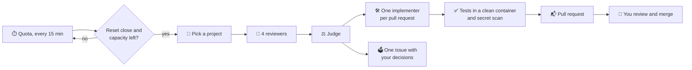

# lastcall ⏰

**Last call before your AI quota resets.**

[](https://github.com/ne0x86/lastcall/actions/workflows/ci.yml)
[](LICENSE)


Your Claude and ChatGPT plans come with weekly limits, and whatever you do not use before the reset is gone. lastcall
watches those limits. When a reset is coming with capacity left over, it spends that capacity on your repositories:
it audits them, fixes what it can in small pull requests verified by your own tests, and leaves the rest in an issue
for you to decide. Nothing reaches your default branch without your approval. 🙌

## ✨ What it does

- 🔎 **Audits.** Four reviewers (bugs, security, hygiene, performance) read your code. A judge checks every finding
  against the code and throws out the noise.
- 🛠️ **Fixes.** One implementer per pull request writes the smallest fix, with a regression test.
- ✅ **Verifies.** lastcall, not the agent, runs your tests again in a clean container and scans the change for
  secrets.
- 📬 **Delivers.** Small pull requests from your own GitHub App, so you can approve them. Decisions it should not
  take go to one issue.
- 🧠 **Remembers.** It never proposes again what you rejected or dismissed, and it finishes what did not fit last
  time.
- ⏳ **Picks its moment.** It spends only capacity that would otherwise expire. It keeps a reserve for you and stops
  before any paid usage.
- 🖥️ **Shows you everything.** A dashboard in English and Spanish: what is left of every quota, the next burst, the
  pull requests to review and the decisions waiting for you.
- 🔔 **Tells you.** A notification when a pull request opens, a decision waits, an audit fails or an account needs
  you: Telegram, ntfy, Discord, Slack, email and many more, through Apprise.

<p align="center"></p>

## 🔁 How it works



**A real first run** on a small Python project, with a Claude Team seat:
- four reviewers and the judge took about 3 minutes and 0.56 USD-equivalent of the subscription; the weekly quota did
  not move;
- 11 findings, 7 confirmed;
- 3 pull requests with new tests, all green in a clean container.

## 🛡️ Safe by design

- 📦 Every agent step runs in a throwaway container: unprivileged, no capabilities, and the code read-only for
  reviewers.
- 🌐 The only way out is a proxy that allows the model API and package registries. No LAN, no GitHub, no other
  domain.
- 🔑 Agents never hold GitHub credentials and never push. lastcall does, after verifying.
- 🙈 Your subscription login stays in the official CLI's own storage. lastcall never reads it.
- 🧑‍⚖️ Nothing is merged without you.

## 🚀 Quickstart

You need Docker 26 or later and a GitHub account. It runs on Linux, macOS, and Windows with Docker Desktop.

**1. Start the sandbox** (egress proxy and supervisor):

```sh
git clone https://github.com/ne0x86/lastcall && cd lastcall
docker compose up -d
```

**2. Create your GitHub App.** It takes one click, and it stays private to you. Open http://127.0.0.1:8765 when the
command says `Ready`, then install the App on the repositories lastcall may work on.

```sh
docker compose run --rm -p 127.0.0.1:8765:8765 cli github setup --owner <your-github-login>
```

**3. Sign in your AI accounts** with their own official login. lastcall never sees it.

```sh
ACCOUNT=claude-max docker compose run --rm login-claude-code   # Claude: paste the code back
ACCOUNT=chatgpt docker compose run --rm login-codex            # Codex: a device code
```

On PowerShell: `$env:ACCOUNT="claude-max"; docker compose run --rm login-claude-code`.

**4. Tell lastcall about them** and check what is left this week:

```sh
docker compose run --rm cli account add claude-max --engine claude-code --language English
docker compose run --rm cli quota claude-max
```

**5. Choose your projects.** lastcall suggests them and says why:

```sh
docker compose run --rm cli github repos
docker compose run --rm cli project add <owner/name>
```

**6. Audit.** Read the findings first, open the pull requests, or let lastcall run on its own:

```sh
docker compose run --rm cli audit <owner/name> --account claude-max --report-only   # findings only
docker compose run --rm cli deliver <run> --account claude-max                       # then the pull requests
docker compose --profile service up -d                                               # 🤖 on its own from now on
```

**7. Open the dashboard** 🖥️ at http://127.0.0.1:8080. The first time, it asks for the setup code that the service
writes to its log, and you choose your password:

```sh
docker compose logs lastcall        # Web UI setup code: XXXX-XXXX
```

The dashboard shows your accounts, the next burst, what is running and what waits for you, and it pauses or resumes
the bursts. The **Projects** page suggests repositories and says why, adds one by its address, changes each
project's priority and language, and starts an audit when you ask. In **Settings**, add where lastcall should
notify you (an [Apprise URL](https://github.com/caronc/apprise/wiki) per destination) and choose what about. From
the terminal, `docker compose run --rm cli status` shows the same, and `cli pause` and
`cli resume` hold or release the bursts. The dashboard listens only on this machine; to open it from elsewhere, put
a reverse proxy with HTTPS in front of it and set `LASTCALL_TRUST_PROXY=1`.

## ⚖️ Provider terms and responsible use

Subscription plans are meant for each vendor's own tools. lastcall follows these rules:
- it runs each vendor's **official, unmodified CLI**;
- it never handles your subscription credentials;
- it never offers a hosted version.

API keys will be a first-class alternative. Read the current terms of your provider before you connect an account;
[DESIGN.md](DESIGN.md#3-provider-terms-and-responsible-use) has the details and the sources. This is not legal
advice.

## 🗺️ Roadmap

- ✅ **v0.1, command line.**
  - The whole audit: find, judge, fix, verify, deliver.
  - Engines: Claude Code and Codex. Forge: GitHub.
  - Memory of findings, and the service that bursts on its own.
  - Scanners in the context pack: gitleaks, osv-scanner, semgrep and hadolint.
- 🔜 **v0.2.**
  - A web UI in English and Spanish, with notifications: Telegram, ntfy, Discord, email and more.
- 🔭 **v0.3.**
  - API keys and local models: opencode, OpenRouter, Ollama.
  - More recipes: issues, tests, dependencies.
  - GitLab and Forgejo.

## 🧑‍💻 Development

You need [uv](https://docs.astral.sh/uv/) and Docker.

```sh
uv sync                                     # the environment
uv run pytest                               # unit tests
uv run ruff check && uv run ruff format --check && uv run mypy
```

To build every image from your checkout and run the sandbox tests against the real containers, use the dev override
(on Windows the separator is `;`):

```sh
export COMPOSE_FILE=compose.yaml:compose.dev.yaml
docker compose --profile build --profile cli --profile test build
docker compose --profile test run --rm it
```

How it all fits together: [DESIGN.md](DESIGN.md).

## 📄 License

[Apache-2.0](LICENSE)
