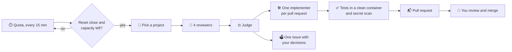

# lastcall ⏰

**Last call before your AI quota resets.**

[](https://github.com/ne0x86/lastcall/releases/latest)
[](https://github.com/ne0x86/lastcall/actions/workflows/ci.yml)
[](LICENSE)


Your Claude and ChatGPT plans come with weekly limits, and whatever you do not use before the reset is gone. lastcall
watches those limits. When a reset is coming with capacity left over, it spends that capacity on your repositories:
it audits them, fixes what it can in small pull requests verified by your own tests, and leaves the rest in an issue
for you to decide. Nothing reaches your default branch without your approval. 🙌

## ✨ What it does

- 🔎 **Audits.** Four reviewers (bugs, security, hygiene, performance) read your code. A judge checks every finding
  against the code and throws out the noise. With several accounts, Claude and Codex can review the same project
  together, and one judge keeps what holds: each finds things the other misses.
- 🛠️ **Fixes.** One implementer per pull request writes the smallest fix, with a regression test.
- ✅ **Verifies.** lastcall, not the agent, runs your tests again in a clean container and scans the change for
  secrets.
- 📬 **Delivers.** Small pull requests from your own GitHub App, so you can approve them. Decisions it should not
  take go to one issue.
- 🧠 **Remembers.** It never proposes again what you rejected or dismissed, and it finishes what did not fit last
  time.
- ⏳ **Picks its moment.** It spends only capacity that would otherwise expire. It keeps a reserve for you and stops
  before any paid usage.
- 🖥️ **Shows you everything.** A dashboard in English and Spanish: what is left of every quota, the next burst, the
  pull requests to review and the decisions waiting for you.
- 🔔 **Tells you.** A notification when a pull request opens, a decision waits, an audit fails or an account needs
  you: Telegram, ntfy, Discord, Slack, email and many more, through Apprise.

<p align="center"></p>

## 🔁 How it works



**A real first run** on a small Python project, with a Claude Team seat:
- four reviewers and the judge took about 3 minutes and 0.56 USD-equivalent of the subscription; the weekly quota did
  not move;
- 11 findings, 7 confirmed;
- 3 pull requests with new tests, all green in a clean container.

## 🛡️ Safe by design

- 📦 Every agent step runs in a throwaway container: unprivileged, no capabilities, and the code read-only for
  reviewers.
- 🌐 The only way out is a proxy that allows the model API and package registries. No LAN, no GitHub, no other
  domain.
- 🔑 Agents never hold GitHub credentials and never push. lastcall does, after verifying.
- 🙈 Your subscription login stays in the official CLI's own storage. lastcall never reads it.
- 🧑‍⚖️ Nothing is merged without you.

## 🔌 Engines

lastcall drives each vendor's official command-line tool, with your own login:

| Engine | Plans | Quota it reads |
|---|---|---|
| Claude Code (`claude-code`) | Claude Pro, Max and Team | the 5-hour and weekly windows, and each model's own weekly window, exactly |
| Codex (`codex`) | ChatGPT Plus, Pro and Business | the 5-hour and weekly windows, exactly |

The rest of lastcall only knows the engine contract. Adding another tool is one module and a few small changes:
[CONTRIBUTING.md](CONTRIBUTING.md#adding-an-engine) lists them. The next engine on the roadmap is opencode, for
API keys, OpenRouter and local models.

## 🚀 Quickstart

You need Docker 26 or later and a GitHub account. It runs on Linux, macOS, and Windows with Docker Desktop.

**1. Start lastcall:**

```sh
git clone --branch v0.3.0 https://github.com/ne0x86/lastcall && cd lastcall
docker compose up -d
```

**2. Open http://127.0.0.1:8080** 🖥️ and choose your password. To show that the instance is yours, copy the setup
code from the log:

```sh
docker compose logs lastcall        # Web UI setup code: XXXX-XXXX
```

**3. Follow the dashboard.** It walks you through the rest:

- 🐙 **GitHub App.** One click creates it, private to you. Then install it on the repositories lastcall may work on.
- 🤖 **Accounts.** Add your Claude or ChatGPT plan, and sign it in with its own official login. lastcall never
  sees it:

  ```sh
  ACCOUNT=claude-max ENGINE=claude-code docker compose run --rm login   # Claude: paste the code back
  ACCOUNT=chatgpt ENGINE=codex docker compose run --rm login            # Codex: a device code
  ```

  On PowerShell: `$env:ACCOUNT="claude-max"; $env:ENGINE="claude-code"; docker compose run --rm login`.
- 📁 **Projects.** lastcall suggests your repositories and says why. Add the ones you want, or any by its address.
- 🔔 **Settings.** Where lastcall should notify you. Choose the service and fill in what it asks for: Telegram (paste
  your bot's token and lastcall finds your chat), ntfy, Discord, Slack or email, or any of the
  [services that Apprise reaches](https://github.com/caronc/apprise#supported-notifications). lastcall saves a
  destination only once its test notification gets through.

That is all. When a reset comes with capacity left, lastcall bursts on its own, and the dashboard shows what it
does. Pause it from the dashboard at any time, or start an audit yourself from the Projects page.

The web UI listens only on this machine. To open it from elsewhere, put a reverse proxy with HTTPS in front of it
and set `LASTCALL_TRUST_PROXY=1`.

To upgrade, check out the new release and pull its images; your settings and history stay in Docker volumes:

```sh
git fetch --tags && git checkout v0.3.0      # the release you want
docker compose pull && docker compose up -d
```

<details>
<summary>Prefer the terminal? Everything works from the command line too.</summary>

```sh
docker compose run --rm -p 127.0.0.1:8765:8765 cli github setup --owner <your-github-login>
docker compose run --rm cli account add claude-max --engine claude-code --language English
docker compose run --rm cli quota claude-max
docker compose run --rm cli github repos
docker compose run --rm cli project add <owner/name>
docker compose run --rm cli audit <owner/name> --account claude-max --report-only   # findings only
docker compose run --rm cli deliver <run> --account claude-max                       # then the pull requests
docker compose run --rm cli status                                                   # accounts, bursts, findings
docker compose run --rm cli pause                                                    # or resume
```

</details>

## ⚙️ Your project's settings

lastcall verifies every change by running your tests again in a clean container. It finds the environment on its
own for Python and Node.js, and for Go (`go.mod`), Rust (`Cargo.toml`) and Java with Maven (`pom.xml`), which run in
their official images. A devcontainer with an `image` works too. For anything else, or to change what it found, add
a `.lastcall.yml` to the root of your repository:

```yaml
test: go test ./...              # the command that runs your tests
environment:
  image: golang:1.23             # where the setup and the tests run
  setup: go mod download         # before the tests: a command, or a list of them
exclude: [vendor/, testdata/]    # paths the audit leaves out
focus: The HTTP handlers in internal/api matter most.
```

Every key is optional. The suggestions on the Projects page say which repositories bring their own environment.

## ⚖️ Provider terms and responsible use

Subscription plans are meant for each vendor's own tools. lastcall follows these rules:
- it runs each vendor's **official, unmodified CLI**;
- it never handles your subscription credentials;
- it never offers a hosted version.

API keys will be a first-class alternative. Read the current terms of your provider before you connect an account;
[DESIGN.md](DESIGN.md#3-provider-terms-and-responsible-use) has the details and the sources. This is not legal
advice.

## 🗺️ Roadmap

- ✅ **v0.1, command line.**
  - The whole audit: find, judge, fix, verify, deliver.
  - Engines: Claude Code and Codex. Forge: GitHub.
  - Memory of findings, and the service that bursts on its own.
  - Scanners in the context pack: gitleaks, osv-scanner, semgrep and hadolint.
- ✅ **v0.2, web UI.**
  - Setup from the browser, dashboard, projects and accounts, in English and Spanish.
  - Notifications: Telegram, ntfy, Discord, email and more.
- ✅ **v0.3, more projects, more eyes.**
  - `.lastcall.yml` in your repositories, devcontainer images, and Go, Rust and Java out of the box.
  - A second attempt at a fix when the project's check fails, with the check's output.
  - Fan-out: Claude and Codex audit the same project, and one judge keeps what holds.
  - Engines are plug-ins: one module each, and one login command for all of them.
- 🔜 **v0.4, closer to the merge.**
  - The `improve` recipe, and reviewers that your repository defines.
  - Merge on approve; watch after the merge and revert.
  - ✅ The gate checks the weekly window of each model.
- 🔭 **v0.5, wider reach.**
  - API keys and local models: opencode, OpenRouter, Ollama.
  - More recipes: issues, tests, dependencies.
  - GitLab and Forgejo.

## 🧑‍💻 Development

You need [uv](https://docs.astral.sh/uv/) and Docker.

```sh
uv sync                                     # the environment
uv run pytest                               # unit tests
uv run ruff check && uv run ruff format --check && uv run mypy
```

To build every image from your checkout and run the sandbox tests against the real containers, use the dev override
(on Windows the separator is `;`):

```sh
export COMPOSE_FILE=compose.yaml:compose.dev.yaml
docker compose --profile build --profile cli --profile test build
docker compose --profile test run --rm it
```

A release sets the version in three places that a test keeps in agreement: `__version__`, the image tag in
`compose.yaml` and the tag that the quickstart clones. How it all fits together: [DESIGN.md](DESIGN.md).

## 🤝 Contributing

Issues and pull requests are welcome: [CONTRIBUTING.md](CONTRIBUTING.md) explains how, including how to add an
engine. Please report security problems privately, as [SECURITY.md](SECURITY.md) says. Everyone who takes part
follows the [code of conduct](CODE_OF_CONDUCT.md).

## 📄 License

[Apache-2.0](LICENSE)
